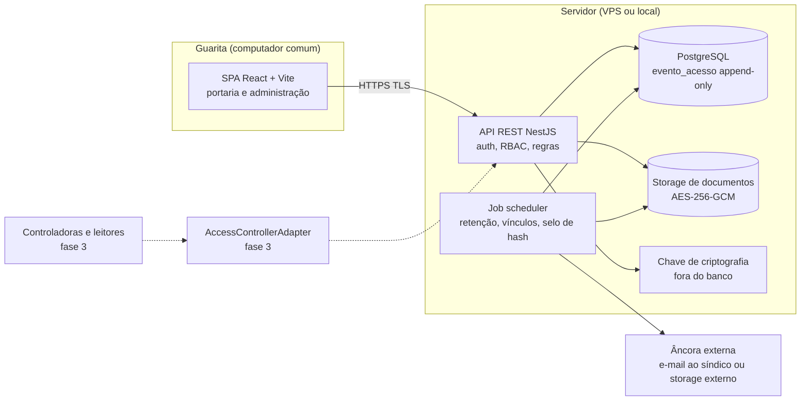
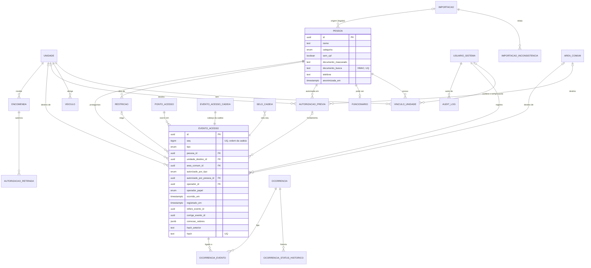
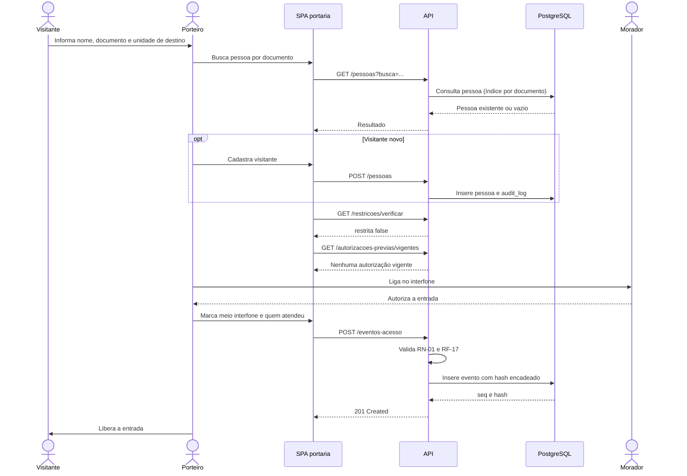
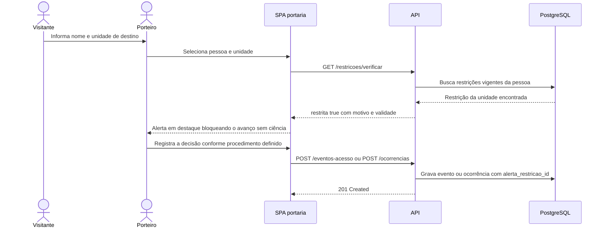
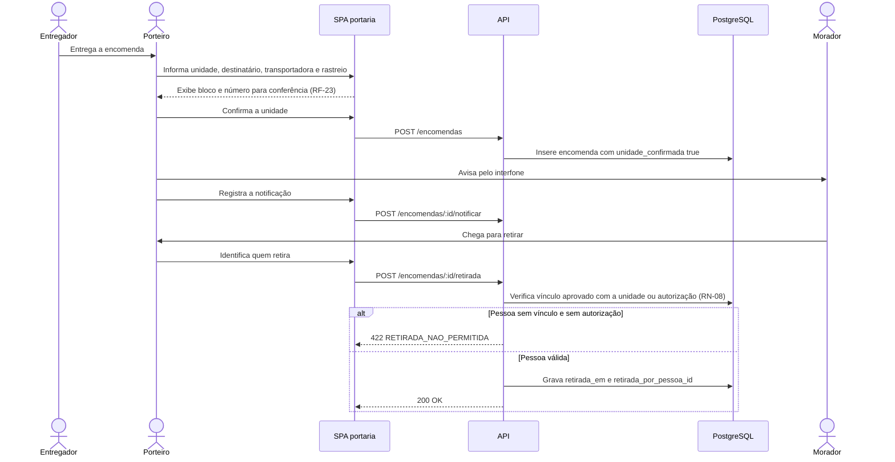

# Sistema de Controle de Acesso e Gestão de Portaria — Especificação Técnica

> Anexo técnico de implementação do documento de requisitos
> [01_requisitos.md](01_requisitos.md). Os IDs RF, RN e RNF citados aqui são os daquele documento.
> Em caso de divergência, vale o documento de requisitos.

| Item | Valor |
|---|---|
| Versão | 0.1 (rascunho) |
| Data | 2026-10-09; seções 3, 4 e 14 revisadas em 2026-10-17 (schema implementado) |
| Contexto | 162 unidades (provisório: confirmar o térreo), 9 blocos (A a I), 500 a 600 moradores, ~175 veículos, portaria social 24h |
| Premissas já decididas | Portaria presencial (porteiro opera, morador não usa o sistema no MVP); software primeiro, sem hardware no MVP; API e front separados |
| Stack | Backend NestJS (TypeScript), PostgreSQL 16+, Drizzle ORM; frontend React + Vite (SPA) |

Justificativa da stack: TypeScript de ponta a ponta e uma única API REST. Drizzle foi escolhido em vez de
Prisma e TypeORM por quatro motivos. É SQL-first: o schema em TypeScript espelha as tabelas, e as consultas
são SQL tipado. As migrações saem em SQL legível, gerado pelo drizzle-kit e revisável, e as manuais (triggers,
funções de hash, GRANT/REVOKE) convivem no mesmo histórico, o que importa para uma trilha append-only. Os tipos
são inferidos do schema sem gerar cliente. E há driver para PGlite (Postgres em WASM), que roda os testes do
banco com as migrações reais, sem Docker.

---

## 1. Visão de arquitetura

### 1.1 Componentes

| Componente | Responsabilidade | Requisitos |
|---|---|---|
| SPA portaria/admin (React + Vite) | Telas de portaria (operação por teclado, fluxo em até 3 telas) e de administração/relatórios | RNF-07, RNF-08 |
| API REST (NestJS) | Regras de negócio, autenticação, RBAC, validações, geração de relatórios e exportação | RN-01 a RN-10, RNF-02, RNF-04 |
| PostgreSQL | Dados relacionais; trilha de eventos append-only com encadeamento de hash | RNF-01, RNF-10 |
| Storage de documentos | Arquivos (fotos opcionais e anexos de ocorrência) criptografados em repouso, fora do banco; o banco guarda só metadados e caminho | RNF-03 |
| Job scheduler | Retenção LGPD, encerramento de vínculos vencidos (RF-07), expiração de autorizações e restrições, selo diário da cadeia de hash, alerta de encomendas pendentes (RF-26) | RF-07, RF-26, RNF-09 |
| Adapter de hardware (fase 3) | Isola controladoras e leitores; converte eventos de hardware em `evento_acesso` | RF-10, RNF-12 |

### 1.2 Diagrama



Linhas tracejadas indicam componentes de fases posteriores.

### 1.3 Hospedagem

Recomendação para o MVP: VPS de baixo custo com TLS (certificado automático via Let's Encrypt e
proxy reverso), atendendo ao RNF-11 (sem licença por unidade) e ao RNF-03. O cliente na guarita é só o
navegador de um computador comum.

A escolha entre nuvem e servidor local na guarita fica em aberto (seção 14). Tradeoff:

| Critério | Nuvem (VPS) | Servidor local na guarita |
|---|---|---|
| Queda de internet | Portaria para de usar o sistema; aciona contingência em papel (1.4) | Continua funcionando na rede local |
| Queda de energia | Só afeta o computador da guarita | Afeta também o servidor; exige nobreak |
| Backup e manutenção | Feitos pelo provedor e pela rotina do projeto | Responsabilidade do condomínio; risco de disco único e de falta de quem opere |
| Custo | Mensalidade baixa e previsível | Hardware, nobreak e suporte |
| Segurança física | Provedor | Guarita (acesso físico por terceiros) |

### 1.4 Contingência (RNF-05)

Procedimento documentado para queda de internet ou energia:

1. O porteiro registra os acessos em formulário de papel numerado, com hora, pessoa, unidade, quem autorizou e meio.
2. Restabelecido o sistema, o porteiro lança os registros como eventos retroativos.
3. O evento retroativo grava `retroativo = true`; `ocorrido_em` recebe a hora do papel e `registrado_em` recebe o instante do lançamento (sempre gerado pelo servidor, nunca informado pelo cliente).
4. A API exige `ocorrido_em` anterior a `registrado_em` quando `retroativo = true`, e o número do formulário de papel em `observacao`.
5. O relatório de auditoria (RF-30) lista os retroativos separadamente; o formulário de papel é arquivado pela administração.

Regra de consistência: `retroativo = false` exige `ocorrido_em` dentro de uma tolerância de
alguns minutos de `registrado_em` (parâmetro configurável, valor inicial de 5 minutos).

---

## 2. Convenções

- Chaves primárias `uuid` gerados por `gen_random_uuid()` (v4). O PostgreSQL 16/17 não tem uuid v7 nativo, e a ordem que importa é a de `seq` em `evento_acesso`, que tem `seq bigint` contínuo para a cadeia. Ao migrar para o PostgreSQL 18, o default pode virar `uuidv7()` sem mudar o schema.
- Todos os instantes em `timestamptz(3)` (milissegundos, a precisão do JavaScript), armazenados em UTC e exibidos em America/Sao_Paulo.
- Tabelas e colunas em snake_case; o schema Drizzle usa camelCase no TypeScript.
- Nada é apagado pela API: remoção lógica (`ativo`, `revogada_em`, `encerrado_em`); alterações vão para `audit_log` (seção 3.3).
- Enumerações como tipos `enum` do PostgreSQL.

---

## 3. Modelo de dados

Implementado em `apps/api/src/db/schema.ts` (Drizzle) e nas migrações de `apps/api/drizzle/`:
`0000_init.sql`, gerada pelo drizzle-kit (tabelas, enums, FKs, CHECKs e índices, inclusive os parciais), e
`0001_regras_imutabilidade.sql`, escrita à mão (funções de hash, triggers, máquinas de estado, procedimentos
de LGPD e GRANT/REVOKE), e `0002_conferencia_comprovante.sql` (RF-05: conferência do comprovante no
vínculo, gerada pelo drizzle-kit, mais a nova versão do trigger `vinculo_unidade_transicao`, escrita à mão).
Migração aplicada não é editada: mudança nova entra numa migração nova. São aplicadas, nesta ordem, nos testes
(`apps/api/test`, PGlite) e em produção. Como aplicar: `db/README.md`.

O modelo segue as decisões de MVP de 2026-10-17: morador não opera o sistema, cadastro só por CPF, comprovante
de vínculo conferido pela administração e registrado sem guardar o arquivo (RF-05), 2FA fora do MVP e auditoria total. Regra que depende de papel do usuário ou de
estado de outra tabela no momento da escrita fica na API, e está marcada como "regra da API" abaixo.

### 3.1 Diagrama ER



O diagrama mostra as relações e as colunas centrais. A definição completa está em 3.2 e no `schema.ts`.

### 3.2 Tabelas

Convenção: PK = chave primária, FK = chave estrangeira, NN = not null, UQ = unique. Todo instante é
`timestamptz(3)`, e o app_rw não tem DELETE em nenhuma tabela (remoção lógica). Os nomes de CHECK
citados existem no banco e aparecem na mensagem de erro.

#### unidade, area_comum, ponto_acesso (RF-01, RF-36)

| Tabela | Colunas | Restrições |
|---|---|---|
| unidade | id, bloco text, numero text, ativo, criado_em, atualizado_em | UQ (bloco, numero); bloco `^[A-Z0-9]{1,3}$` ("A", "4", "B2"); numero só dígitos, mínimo 2 e sem zero à esquerda além da dezena ("03", "32"; a API normaliza "3" -> "03"). Nunca excluída: FKs sem cascade e sem DELETE para app_rw (exceção: `unidade_descartar_estrutura()`, só sem nenhuma referência) |
| area_comum | id, nome, ativo | UQ nome. Destino de prestador e de autorização prévia de área comum |
| ponto_acesso | id, nome, ativo | UQ nome. Seed com a única "Portaria social"; tabela pronta para garagem e dispositivos (fase 3) |

A estrutura inicial é declarativa (`ESTRUTURA_PADRAO` em `@portaria/domain/units`): agrupamento ("Bloco" ou "Torre", só muda o rótulo: "BLOCO A · AP 32"; o código é "A-32"), blocos, andares (0 = térreo), finais por andar e unidades ausentes ("01" em todos os blocos, "A-01" só num). Número = andar × 10 + final. Padrão: blocos A a I, andares 0 a 4, finais 1 a 4, sem 01 e 02 no térreo (162 unidades, provisório). O seed (`apps/api/src/db/seed.ts`) cria essas unidades, o ponto de acesso e as áreas comuns (o mesmo que o mock usa). Usuários e pessoas não entram no seed. Exceções à grade entram pelo CRUD (RF-01) ou pela importação. Banco sem nenhum uso de unidade e com outra estrutura: CLI `recriar-estrutura` (substitui as unidades e grava no audit_log; recusa se houver qualquer referência).

#### usuario_sistema (RN-05, RF-33)

| Coluna | Tipo | Restrições |
|---|---|---|
| id, nome | uuid, text | PK, NN |
| login | text | UQ em `lower(login)` |
| senha_hash | text | NN, CHECK formato argon2id (`$argon2id$...`) |
| papel | enum (sindico, administracao, porteiro, auditor) | NN |
| ativo | boolean | NN; desativar não apaga o histórico (FKs de evento e trilha) |
| ultimo_acesso | timestamptz | gravado no login |
| deve_trocar_senha | boolean | NN, default true: senha criada por terceiro (cadastro ou redefinição) só dá acesso a `/auth/me`, `/auth/logout` e `/auth/trocar-senha` |
| senha_alterada_em | timestamptz | última troca ou redefinição |

Sem colunas de 2FA no MVP: o 2FA foi para a fase de segurança. `falhas_login` e `bloqueado_ate` saíram na migração 0003:
o bloqueio vive em `login_limite`, igual para login existente e inexistente.

#### sessao e login_limite (§5.1, migração 0003)

| Tabela | Colunas | Restrições e permissões |
|---|---|---|
| sessao | id, token_hash (SHA-256 hex do token opaco), usuario_id, criada_em, ultimo_uso_em, expira_em, revogada_em, motivo_revogacao, ip, user_agent | UQ token_hash; CHECK do formato do hash, `expira_em > criada_em`, motivo em (logout, desativacao, troca_senha, redefinicao_senha) junto com revogada_em. `app_rw`: SELECT, INSERT e UPDATE só de ultimo_uso_em, revogada_em e motivo_revogacao; sem DELETE |
| login_limite | (tipo, chave) PK, falhas, janela_inicio, bloqueado_ate, atualizado_em | tipo em (login, ip); chave = HMAC-SHA256 (subchave HKDF de `PORTARIA_HMAC_CPF_KEY`) do login normalizado ou do IP, porque o login digitado pode ser um CPF. Uma linha por chave, atualizada por UPSERT atômico. `app_rw`: SELECT, INSERT e UPDATE das colunas do contador; sem DELETE |

#### pessoa (RF-02, RN-10)

| Coluna | Tipo | Restrições |
|---|---|---|
| id | uuid | PK |
| nome | text | NN, não vazio |
| categoria | enum (visitante, prestador, morador, funcionario) | NN. Vira `morador` só na aprovação do vínculo (regra da API) |
| sem_cpf | boolean | NN, default false. Sem CPF, a pessoa só entra por `excecao_porteiro` (trigger do evento) |
| documento_mascarado | text | `***.456.789-**`; o CHECK impede gravar um CPF completo aqui |
| documento_busca | text | UQ; HMAC-SHA256 (hex) dos 11 dígitos, com a chave `PORTARIA_HMAC_CPF_KEY` |
| telefone | text | só dígitos (10 ou 11); NN, exceto importado (legado) ou anonimizado |
| empresa, servico | text | empresa obrigatória para prestador; serviço opcional |
| foto_documento_id | uuid | FK documento, opcional (RN-10) |
| importacao_id | uuid | FK importacao: origem do cadastro legado |
| anonimizada_em | timestamptz | preenchido pela anonimização; o CHECK exige documento, telefone e foto nulos |

CHECK `pessoa_documento_coerente_ck`: com CPF, o mascarado e a busca são obrigatórios; sem CPF, os dois são
nulos. **O número do CPF não é armazenado**, nem em claro nem cifrado (decisão 18 da seção 14).

#### funcionario (RF-09)

`pessoa_id` (PK e FK), `funcao`, `dias_semana smallint[]` (0 = domingo; de 1 a 7 valores entre 0 e 6),
`hora_inicio` e `hora_fim` (`time`, diferentes entre si) e `ativo`. Com fim < início, a escala atravessa
a meia-noite e vale no dia do início do turno, como em `escalaVigente` do domain.

#### vinculo_unidade (RF-03 a RF-07, RN-02, RN-03, RN-09)

| Coluna | Tipo | Restrições |
|---|---|---|
| id, pessoa_id, unidade_id | uuid | PK, FK, FK |
| tipo | enum (proprietario, inquilino, dependente) | NN; inquilino exige `vigencia_fim` (exceto legado/encerrado) |
| status | enum (pendente, aprovado, rejeitado, legado, encerrado) | NN, default pendente |
| vigencia_inicio, vigencia_fim | date | fim ≥ início |
| prazo_regularizacao | date | NN se legado (RN-09) |
| conferencia_tipo_documento | enum `tipo_comprovante` (escritura, contrato_compra_venda, contrato_locacao, outro) | conferência do comprovante (RF-05); NN em aprovado (`vinculo_aprovado_conferido_ck`) |
| conferencia_data | date | data em que a administração conferiu; ≤ data de `decidido_em` (`vinculo_conferencia_antes_decisao_ck`); não futura (regra da API) |
| conferido_por_id | uuid | FK usuario_sistema; tipo, data e conferente vêm juntos (`vinculo_conferencia_completa_ck`); só síndico ou administração (regra da API, `vinculo.decidir`) |
| conferencia_descricao | text | NN se, e somente se, tipo = outro; até 80 caracteres (`vinculo_conferencia_descricao_ck`) |
| conferencia_observacao | text | opcional, até 200 caracteres, **sem dado pessoal** (`vinculo_conferencia_observacao_ck`; `vinculo_conferencia_sem_numero_ck` barra 9+ dígitos seguidos, ou seja, CPF e telefone) |
| registrado_por_id, registrado_em, importacao_id, nota | | quem cadastrou; origem da importação |
| decidido_por_id, decidido_em | | os dois juntos; obrigatórios em aprovado e rejeitado |
| justificativa | text | obrigatória em rejeitado |
| encerrado_em | timestamptz | NN se, e somente se, encerrado (RF-07 e fim do vínculo para a retenção) |

Índice parcial UQ `(pessoa_id, unidade_id) WHERE status IN (pendente, aprovado, legado)`. O trigger
`vinculo_unidade_transicao` faz o vínculo nascer pendente ou legado e só permite estas transições:
pendente → aprovado | rejeitado; aprovado → encerrado; legado → aprovado (regularização) | encerrado.
Rejeitado e encerrado são finais. Regras da API: aprovar exige pessoa com CPF (não `sem_cpf`) e telefone,
e a decisão é só de síndico ou administração (RN-03).

Conferência do comprovante (RF-05, RN-02): uma conferência vigente por vínculo, em colunas do próprio vínculo
(decisão 25 da seção 14). Aprovar e regularizar legado (legado → aprovado) exigem conferência registrada, e
quem garante é o CHECK `vinculo_aprovado_conferido_ck`. Enquanto o vínculo está pendente ou legado, a conferência
pode ser refeita (`POST /vinculos/:id/conferencias` substitui a anterior), e cada registro gera `vinculo.conferir`
no `audit_log` com antes e depois, que é o histórico. Depois de aprovado, o trigger `vinculo_unidade_transicao`
(versão da 0002) congela as colunas `conferencia_*` e `conferido_por_id`. O arquivo do comprovante não é
armazenado (LGPD, art. 6º, III). A observação é orientada na tela a não conter dado pessoal, e o CHECK só barra o
caso detectável (sequência numérica de CPF ou telefone).

#### documento (RNF-03, opcional no MVP)

Metadados do arquivo cifrado: `tipo`, `caminho_storage`, `dek_cifrada` (DEK do arquivo cifrada pela KEK),
`nonce`, `chave_versao`, `sha256_conteudo`, `mime`, `tamanho_bytes`, `enviado_por_id`, `enviado_em` e
`eliminado_em`. Serve à foto e aos anexos de ocorrência. O comprovante de vínculo não vem para cá (RF-05):
a 0002 removeu `vinculo_unidade.documento_id` e o valor `comprovante_vinculo` do enum `tipo_documento`.

#### veiculo (RF-08)

`unidade_id`, `placa` (7 caracteres, maiúsculas, sem hífen), `modelo`, `cor`, `ativo`; índice parcial UQ `placa WHERE ativo`.

#### autorizacao_previa (RF-14, RN-07)

| Coluna | Restrições |
|---|---|
| pessoa_id | FK, NN (quem é autorizado) |
| unidade_id / area_comum_id | exatamente um dos dois. Área comum só síndico/administração criam (regra da API) |
| valida_de, valida_ate | NN, ate > de (RN-07) |
| dias_semana smallint[], hora_inicio, hora_fim | dias entre 0 e 6 ou nulo (todos); horas ambas ou nenhuma, fim > início |
| solicitada_por_pessoa_id | morador que pediu (vínculo válido na unidade: regra da API) |
| sem_solicitante, justificativa | na unidade: `sem_solicitante` ⇔ sem solicitante, e então justificativa ≥ 15 caracteres (conta como exceção de quem cadastrou no RF-31). Na área comum: sem solicitante e `sem_solicitante = false` (a administração é a solicitante) |
| cadastrada_por_id, cadastrada_em | NN |
| revogada_por_id, revogada_em | os dois juntos. Depois de revogada, o registro congela (trigger): revogar duas vezes é proibido |

#### restricao (RF-15, RF-16, RN-06)

`escopo` (unidade, condominio), `unidade_id`, `pessoa_id`, `motivo`, `valida_ate`, `solicitada_por_pessoa_id`,
`cadastrada_por_id`, `cadastrada_em`, `aprovada_por_id`/`aprovada_em` e `revogada_por_id`/`revogada_em`.
No escopo unidade, unidade e solicitante são obrigatórios e não há aprovação. O escopo condomínio só vale
aprovado; a aprovação é do síndico (regra da API) e, uma vez dada, não muda (trigger). Revogada, congela.

#### evento_acesso (RF-12, RF-13, RF-16, RF-17, RF-35, RF-36, RN-01, RN-04)

Append-only, com hash encadeado (seção 4).

| Coluna | Tipo | Restrições |
|---|---|---|
| id | uuid | PK |
| seq | bigint | UQ; definido pelo trigger (cabeça + 1), sem lacunas |
| formato_hash | smallint | versão da serialização canônica (hoje 1) |
| tipo | enum (entrada, saida, negado, recusado, correcao) | NN |
| categoria_pessoa | enum | NN; categoria efetiva no momento (RN-02) |
| pessoa_id | uuid | FK, NN |
| unidade_destino_id / area_comum_id | uuid | no máximo um; área comum só para prestador; entrada e recusa exigem destino, exceto funcionário |
| ponto_acesso_id | uuid | FK, NN |
| autorizado_por_tipo | enum (interfone, morador_presente, autorizacao_previa, excecao_porteiro, escala) | NN em entrada de não morador (RN-01); só em entrada e recusado |
| autorizado_por_pessoa_id | uuid | FK pessoa. Obrigatório em interfone e morador presente; nulo em exceção e escala. **Não há coluna de nome copiado** |
| autorizacao_previa_id | uuid | NN ⇔ meio = autorizacao_previa |
| justificativa | text | ≥ 15 caracteres em exceção (RF-17) e em correção (RN-04) |
| restricao_id | uuid | NN ⇔ tipo = negado (RF-16) |
| operador_id, operador_papel | uuid, enum | NN; papel no momento do registro; auditor não registra |
| ocorrido_em | timestamptz(3) | fora da contingência, o trigger iguala a `registrado_em` |
| registrado_em | timestamptz(3) | relógio do servidor (trigger), monotônico em `seq` |
| retroativo, formulario_contingencia | | retroativo ⇔ formulário preenchido, e `ocorrido_em < registrado_em` (RF-35) |
| refere_evento_id | uuid | NN ⇔ saída; o trigger exige uma entrada existente; índice parcial UQ: uma saída por entrada |
| corrige_evento_id | uuid | NN ⇔ correção; o trigger exige evento existente que não seja correção |
| correcao_valores | jsonb | só em correção: subconjunto de `unidade_destino_id`, `ocorrido_em`, `pessoa_id` e `autorizado_por_pessoa_id`, normalizado pelo trigger |
| empresa, servico | text | só em prestador; empresa obrigatória na entrada de prestador |
| observacao | text | |
| hash_anterior, hash | text | hex de 64; `hash` UQ |

Sem FK em `refere_evento_id` e `corrige_evento_id`: o trigger valida na inserção, e o descarte por
retenção (prefixo da cadeia, seção 9.1) não pode ser bloqueado por uma saída ou correção mais nova.
Correção é um evento novo (RN-04). Views e relatórios usam os valores efetivos: o original sobreposto pela
última correção, que acumula os valores das anteriores, como no mock.

`evento_acesso_cadeia` é a linha única com `ultimo_seq`, `ultimo_hash` e `ultimo_registrado_em`. Ela
serializa as inserções e guarda o ponto de continuação mesmo depois do descarte por retenção.

#### encomenda e autorizacao_retirada (RF-22 a RF-26, RN-08)

| Tabela | Colunas e restrições |
|---|---|
| encomenda | `numero` (identity, para exibição), unidade_id, destinatario, transportadora, codigo_rastreio, `unidade_confirmada` (CHECK = true, RF-23), recebida_por_id, recebida_em; retirada: `retirada_em`, `retirada_por_pessoa_id` e `retirada_registrada_por_id`, os três juntos, mais `retirada_autorizacao_id` opcional. Retirada registrada congela o registro (trigger) |
| autorizacao_retirada | encomenda_id, pessoa_autorizada_id, solicitante_pessoa_id (morador com vínculo válido: regra da API), registrada_por_id, registrada_em; UQ (encomenda, pessoa) |

FK composta `(retirada_autorizacao_id, id, retirada_por_pessoa_id)` → `autorizacao_retirada (id, encomenda_id, pessoa_autorizada_id)`:
a autorização usada precisa ser **desta** encomenda e **desta** pessoa. Retirada por vínculo válido (sem
autorização) é regra da API, com a mesma `vinculoValido` do domain.

#### ocorrencia, ocorrencia_status_historico, ocorrencia_evento, ocorrencia_anexo (RF-27, RF-28)

| Tabela | Colunas e restrições |
|---|---|
| ocorrencia | `numero` (identity), tipo, descricao (NN), unidade_id (nulo = área comum), envolvidos, aberta_por_id, aberta_em, status. O trigger faz nascer aberta e só permite aberta → em_andamento → encerrada; encerrada é final |
| ocorrencia_status_historico | ocorrencia_id, de, para (diferentes), por_id, em. Append-only |
| ocorrencia_evento | PK (ocorrencia_id, evento_id); `ON DELETE CASCADE` a partir do evento (o descarte por retenção desfaz o vínculo) |
| ocorrencia_anexo | PK (ocorrencia_id, documento_id) |

Regra da API: o porteiro só altera a ocorrência que ele mesmo abriu.

#### importacao e importacao_inconsistencia (RF-11, RN-09)

`importacao`: arquivo_nome, arquivo_sha256, status (analisada, confirmada, cancelada), contagens (lidas,
importáveis, rejeitadas, avisos, importados, reaproveitados), prazo_regularizacao, executada_por_id,
analisada_em e confirmada_em. Confirmada ⇔ `confirmada_em` e contagens finais preenchidos. A análise
fica persistida entre "analisar" e "confirmar", porque a API é sem estado.
`importacao_inconsistencia`: linha, codigo, mensagem, tipo (aviso, erro).

### 3.3 audit_log (trilha de alterações)

| Coluna | Tipo | Restrições |
|---|---|---|
| id | uuid | PK |
| seq | bigint identity | UQ, ordem de gravação |
| em | timestamptz(3) | default `clock_timestamp()` |
| usuario_id, usuario_papel | uuid, enum | os dois juntos; nulos só em `auth.login_falha` de usuário inexistente |
| usuario_nome | text | NN (no login com falha, o login digitado) |
| acao | text | `entidade.acao`, por exemplo `pessoa.criar`, `vinculo.decidir`, `auth.login`, `auth.login_falha`, `auth.logout`, `acesso.negado` |
| entidade, registro_id | text, uuid | |
| antes, depois | jsonb | snapshots com nomes de coluna do banco; CPF e telefone mascarados pela API |
| ip | inet | |
| redigido_em | timestamptz | preenchido só por `lgpd_redigir_audit_pessoa` |

Toda escrita de cadastro grava um registro na mesma transação, pelo interceptor da API. É append-only
(REVOKE e trigger, seção 4), mas **não é encadeado por hash**. Os snapshots de `pessoa` trazem o nome, e
a anonimização (art. 18 e retenção) precisa removê-lo. Encadear impediria isso, ou exigiria canonizar o
jsonb fora do banco, o que é frágil. A única alteração permitida é a redação controlada (seção 4.2).

### 3.4 Tabelas auxiliares

| Tabela | Finalidade |
|---|---|
| selo_cadeia | Selo diário (seção 4.6): `data` UQ, `ultimo_seq`, `ultimo_hash`, `criado_em`, `enviado_para`, `enviado_em` |
| retencao_execucao | Cada execução de retenção ou redação: tipo, ate_seq, quantidade, detalhes (só ids e contagens). Append-only |

Sessão: o MVP usa token assinado e não persiste sessão no banco; a tabela entra se a revogação de sessão
for exigida. Dispositivo e habilitação (fase 3) entram como migração aditiva quando houver hardware.

### 3.5 Índices (RNF-06)

| Tabela | Índice | Uso |
|---|---|---|
| evento_acesso | (pessoa_id, ocorrido_em desc) | RF-19 por pessoa; último acesso (retenção) |
| evento_acesso | (unidade_destino_id, ocorrido_em desc) | RF-19 por unidade, RF-30 |
| evento_acesso | (operador_id, ocorrido_em desc) | RF-19 por porteiro |
| evento_acesso | (ocorrido_em) | relatórios por período |
| evento_acesso | parcial (operador_id, ocorrido_em) onde exceção | RF-31 |
| evento_acesso | parcial UQ (refere_evento_id) onde saída | uma saída por entrada; RF-20 |
| evento_acesso | parcial (corrige_evento_id) | valores efetivos |
| restricao | parcial (pessoa_id) onde não revogada | RF-16, consulta < 1 s |
| autorizacao_previa | parcial (pessoa_id, unidade_id) onde não revogada | RN-07 na portaria |
| vinculo_unidade | (unidade_id, status), (pessoa_id, status), parcial UQ do vínculo ativo | autorização e RN-08 |
| pessoa | UQ documento_busca | busca por CPF |
| usuario_sistema | UQ lower(login) | login |
| veiculo | parcial UQ (placa) onde ativo | busca por placa |
| encomenda | parcial (unidade_id) onde não retirada | RF-26 |
| audit_log | (entidade, registro_id), (em) | histórico do registro |

Busca por nome (RF-34): com milhares de pessoas, `ILIKE` resolve. `pg_trgm` entra se a medição pedir.

---

## 4. Imutabilidade da trilha (RN-04, RNF-01)

Três camadas, todas na migração `0001_regras_imutabilidade.sql` e cobertas por testes
(`apps/api/test/imutabilidade.test.ts` e `cadeia.test.ts`).

### 4.1 Camada 1: permissões do banco

Os roles são do cluster e são criados fora das migrações, pelo `db/bootstrap/00_roles.sh` (superusuário,
uma vez, senhas do ambiente). A migração `0001` falha se `app_rw` não existir.

| Role | Uso | Privilégios |
|---|---|---|
| app_migrator | Dono do banco e do schema. Roda `drizzle-kit migrate` | tudo nos objetos que criou |
| app_rw | A API | SELECT em tudo. INSERT e UPDATE nos cadastros. Só INSERT em `evento_acesso`, `audit_log`, `selo_cadeia`, históricos e vínculos N:N. UPDATE só das colunas `enviado_para` e `enviado_em` do selo. **Nenhum DELETE nem TRUNCATE.** Nada na cabeça da cadeia e em `retencao_execucao`. EXECUTE só em `retencao_descartar_eventos` e `lgpd_redigir_audit_pessoa` |

Não há `ALTER DEFAULT PRIVILEGES`: tabela nova sem GRANT explícito falha fechada. O auditor é somente
leitura por RBAC da API, porque todos os papéis usam o mesmo role de banco.

### 4.2 Camada 2: triggers

| Trigger | Efeito |
|---|---|
| `trilha_bloqueia_alteracao` | UPDATE, DELETE e TRUNCATE falham em `evento_acesso`, `audit_log`, `ocorrencia_status_historico` e `retencao_execucao`; DELETE e TRUNCATE em `selo_cadeia` e `evento_acesso_cadeia`. Vale até para o dono e para o superusuário enquanto o trigger estiver ativo |
| `selo_cadeia_validar` | O selo precisa conferir com um evento (ou com a cabeça); depois, só o envio pode ser registrado, uma vez |
| `evento_acesso_antes_inserir` | Ver 4.3 |

Exceções controladas: o trigger só deixa passar quando **as duas** condições valem. O `current_user` é o
dono da tabela, o que só acontece dentro de uma função SECURITY DEFINER do dono. E o marcador da transação
`portaria.operacao` indica a operação. As funções são:

- `retencao_descartar_eventos(ate_seq)`: DELETE do prefixo vencido (seção 9.1);
- `lgpd_redigir_audit_pessoa(pessoa_id)`: remove nome, telefone, documento e empresa dos snapshots de uma pessoa já anonimizada.

O app_rw que definir o marcador por conta própria continua sem DELETE ou UPDATE (camada 1).

### 4.3 Camada 3: encadeamento de hash

**Onde se calcula:** no banco, no trigger `BEFORE INSERT` `evento_acesso_antes_inserir`, com a função
nativa `sha256()` do PostgreSQL. Não há extensão. Assim existe uma única fonte de verdade, e nenhum
caminho de escrita (bug da API, script, outra aplicação) grava evento sem hash ou com hash divergente.
O trigger também define `seq`, `registrado_em`, `formato_hash` e, fora da contingência, `ocorrido_em`.
Valores enviados pelo cliente nesses campos são ignorados.

**Serialização das inserções:** o trigger lê a linha única `evento_acesso_cadeia` com `SELECT ... FOR UPDATE`,
usa `seq = ultimo_seq + 1` e `hash_anterior = ultimo_hash`, calcula o hash e atualiza a cabeça. Uma segunda
inserção concorrente espera o COMMIT da primeira e relê a cabeça (READ COMMITTED). Em REPEATABLE READ ou
SERIALIZABLE, ela falha com `40001` e a API repete. Se a transação faz rollback, a cabeça volta junto: não
há lacuna de `seq`, que é o que o verificador acusa. Por isso não se usa sequence, que perde números no
rollback. A trava vale até o COMMIT, então a API deve inserir o evento no fim da transação. `registrado_em`
usa `clock_timestamp()` depois da trava e nunca anda para trás em relação a `seq`.

**Serialização canônica v1** (`evento_acesso_canonico(e)` no banco; `jsonCanonicoV1` em
`@portaria/domain/hashChain`, a mesma usada pelo mock do navegador e reexportada por `apps/api/src/db/cadeia.ts`):

```
hash = hex( SHA-256( UTF-8( hash_anterior || canonico ) ) )
canonico = JSON compacto (sem espaços), chaves nesta ordem:
  v, seq, id, tipo, categoria_pessoa, pessoa_id, unidade_destino_id, area_comum_id, ponto_acesso_id,
  autorizado_por_tipo, autorizado_por_pessoa_id, autorizacao_previa_id, justificativa, restricao_id,
  operador_id, operador_papel, ocorrido_em, registrado_em, retroativo, formulario_contingencia,
  refere_evento_id, corrige_evento_id, correcao_valores, empresa, servico, observacao
```

| Tipo | Representação |
|---|---|
| ausente | `null` (a chave sempre aparece) |
| texto, enum, uuid | string JSON (uuid em minúsculas); escape igual ao `JSON.stringify` |
| `seq`, `v` | número |
| `retroativo` | `true` / `false` |
| instante | string ISO 8601 UTC com milissegundos, `"2026-10-17T12:34:56.789Z"`, igual a `Date.toISOString()`. As colunas são `timestamptz(3)`, então não há arredondamento entre o banco e o verificador |
| `correcao_valores` | objeto só com as chaves presentes, na ordem `unidade_destino_id, ocorrido_em, pessoa_id, autorizado_por_pessoa_id`; valores string ou null. Chave nova entra no fim, sem mudar o hash de correções antigas |

Gênese: `hash_anterior` do seq 1 é SHA-256 hex de `genesis`, o mesmo valor do domain. A string separada
por `|` da v0.1 foi descartada: era ambígua (null = vazio, `|` dentro do texto) e difícil de reproduzir.
`v` (`formato_hash`) permite evoluir os campos canônicos (por exemplo, `veiculo_id` na fase 3) sem invalidar
os eventos antigos.

**Sem PII copiada no hash:** o evento referencia pessoas só por id (`autorizado_por_pessoa_id`), e o nome vem
por join. Anonimizar a pessoa não toca a cadeia. Textos livres (`justificativa`, `observacao`,
`formulario_contingencia`, `empresa`, `servico`) entram no hash. Ver o risco residual na seção 9.1 e a
decisão 17 da seção 14.

Teste obrigatório: o verificador TS independente recalcula a cadeia gravada pelo trigger. A string canônica
do banco é comparada byte a byte com a do TS, inclusive em texto com aspas, barra, quebra de linha,
caractere de controle e emoji. Também se testa a detecção de alteração e de remoção no meio da cadeia.
A inserção concorrente com várias conexões roda em Postgres real (`test/postgres-real`).

### 4.4 Correção de registro

Não há UPDATE. Correção é evento novo (`tipo = correcao`) com `corrige_evento_id`, justificativa de pelo
menos 15 caracteres, operador e, opcionalmente, `correcao_valores`. O trigger rejeita corrigir uma
correção: corrige-se o original, e a última correção prevalece, carregando o acumulado. O campo corrigível
de autorizador é `autorizado_por_pessoa_id`, não um nome livre. Quem pode corrigir está na matriz 5.2
(síndico e administração).

### 4.5 Verificação de integridade

| Item | Descrição |
|---|---|
| Endpoint | `GET /auditoria/integridade?de_seq=&ate_seq=` (auditor, síndico, administração) |
| Processo | Lê os eventos em ordem de `seq` e aplica `verificarCadeia` (o mesmo código do verificador externo), a partir da gênese ou do selo do último descarte |
| Resposta | `{ valido, verificados, ultimo_seq, ultimo_hash }` ou, na falha, `primeiro_seq_invalido` e `motivo` (`hash_divergente`, `hash_anterior_incoerente`, `lacuna_de_seq`) |
| Agendamento | Pendente: o agendador (seção 4.6) já sela e envia a âncora; a verificação diária com alerta ao síndico ainda não roda sozinha (hoje é sob demanda, na tela de Histórico) |

### 4.6 Selo e ancoragem externa

Limitação declarada: quem tem acesso de superusuário ou de dono pode desabilitar os triggers, reescrever
eventos e recalcular a cadeia inteira. O hash detecta alteração parcial, não reescrita completa.

Mitigação: o job diário grava `selo_cadeia` (data, `ultimo_seq`, `ultimo_hash`). O trigger confere o
hash com a cadeia. Em seguida, o job envia a âncora para fora e registra `enviado_para` e `enviado_em`,
uma única vez. Um hash ancorado em D que não coincide com o banco prova reescrita posterior a D. A força
da âncora depende de quem a recebe não ter acesso ao servidor (decisão 2).

Sem a âncora, quem tem superusuário recalcula a cadeia inteira **e reescreve os próprios selos** no banco; a
verificação interna (4.5), que só lê o banco, passa a dizer "íntegra". Isso está provado em `test:pg`
(`postgres-real/lgpd-selo.test.ts`) e no `npm test` (`ancora-github.test.ts`): depois da reescrita completa,
`GET /auditoria/integridade` acusa `selo_divergente`; se o atacante também reescreve o selo, a verificação volta a
"válido", e só a âncora externa denuncia: a trilha exportada não bate com o `selos.jsonl` do branch `ancoras`
(`verificar-ancoras` → `divergente`), a coleta seguinte do GitHub Actions falha e abre uma issue, e o hash recebido por
e-mail, quando esse destino está ligado, também diverge (`POST /auditoria/selos/conferir` → `hash_divergente`).

**Âncora pelo GitHub Actions (2026-10-19, decisão do usuário para o deploy na VPS).** Por que: a âncora só vale se
ficar onde quem administra o servidor não reescreve. O e-mail exigia SMTP com TLS e credencial na VPS, e uma caixa de
correio guardada pelo síndico e pelo conselho sem procedimento de conferência. O GitHub Actions troca isso por um
processo agendado de terceiro que **lê** (o servidor não envia nada e não guarda segredo nenhum) e grava num
histórico público, só por append. Como funciona:

1. A API publica os selos diários num endpoint público, sem parâmetro: `GET /auditoria/selos/publico` (seção 6.6).
2. O workflow `.github/workflows/ancora-selo.yml` roda uma vez por dia (05:17 UTC, 02:17 BRT) e lê o endpoint
   (`vars.ANCORA_URL`). Em seguida, `scripts/ancoras/anexar-selos.mjs` valida o formato, confere os dias já ancorados
   e **anexa** os novos a `selos.jsonl`, no branch órfão `ancoras`, com o `GITHUB_TOKEN` (`contents: write`). As
   actions são fixadas por SHA.
3. Dia já ancorado que volta com seq, hash ou total diferente, selo ancorado que some, seq que regride ou mesmo seq
   com hash diferente: o job **não grava nada**, falha e abre ou comenta uma issue. VPS fora do ar: o job falha sem
   tocar no arquivo; como a resposta traz os últimos 31 selos, a próxima coleta recupera os dias perdidos.
4. Conferência offline (com valor de prova): `node apps/api/dist/cli/verificar-ancoras.js trilha.jsonl selos.jsonl`
   recalcula a cadeia exportada (4.7) e compara o hash de cada dia ancorado.

O que o Actions prova:
- **Carimbo de terceiro:** o hash do dia D foi lido e commitado por um runner do GitHub no dia D+1, numa execução com
  registro próprio (id da execução no commit e na linha). Quem toma a VPS não altera esse registro nem o commit.
- **Histórico público e só por append:** qualquer pessoa clona o branch e vê quando cada linha entrou. Com o branch
  protegido contra force-push e deleção, reescrever uma linha deixa de ser possível sem desligar a proteção, e
  desligá-la fica registrado no log de auditoria do repositório.

O que ele **não** prova:
- **Que a trilha estava correta antes da âncora:** um servidor já adulterado no dia D tem o hash adulterado ancorado. A
  âncora prova que nada mudou **depois** de D.
- **Que o dono do repositório não reescreveu o branch:** quem administra o repositório (hoje, o mesmo responsável
  técnico da VPS) pode desligar a proteção e forçar um push. A mitigação é externa: clones mantidos por terceiros
  (orientador, conselho), o log de auditoria e as notificações do GitHub. Isso fica declarado como limite.
- **Que todo acesso foi registrado:** a âncora protege o que entrou na trilha, e não o que o porteiro deixou de lançar.
- **Validade jurídica:** não é carimbo do tempo ICP-Brasil (01_requisitos.md, seção 11).
- **Continuidade:** o GitHub desativa workflow agendado de repositório público depois de 60 dias sem atividade no
  repositório. O aviso chega por e-mail, e é preciso reativar.

O endpoint público não pode virar oráculo nem relógio da portaria: não aceita parâmetro, só publica selo **diário**
(o manual sela a cabeça num instante qualquer), não traz instante nem id, e o total é por dia. O que ele revela, e é
aceito, é o volume diário agregado do condomínio. Os hashes publicados não abrem o conteúdo dos eventos: conferir um
palpite exigiria o `hash_anterior`, que não é publicado, e os uuids aleatórios do evento. Pelo mesmo motivo, o `/saude`
público deixou de devolver o `ultimo_seq`, que em polling mostrava o instante de cada evento. A resposta fica em
cache por 60 s (a consulta ao banco não cresce com o tráfego) e tem limite próprio de 30 consultas por minuto por IP.

Implementação (2026-10-18, `apps/api/src/selo/`):

| Item | Como funciona |
|---|---|
| Selo diário | Para o dia D (BRT), sela o último evento com `registrado_em` antes da meia-noite de D+1. `tipo = 'diario'`, um por dia (índice único parcial, migração 0004). Cadeia vazia: sela a gênese. Também é o ponto de corte da retenção (9.1) |
| Selo manual | `POST /auditoria/selos` (SI, AU: `auditoria.selar`) sela a cabeça naquele momento, `tipo = 'manual'`, e envia a âncora na hora. Se a cabeça não andou desde o último selo, devolve o existente (sem selo nem e-mail repetido) |
| Âncora | Destinos externos em `ANCORA_DESTINOS` (`github`, `email`). `github`: o selo diário fica disponível no endpoint público e o servidor não envia nada; o manual fica "coberto pelo próximo selo diário", cujo hash depende de todos os eventos anteriores. `email`: resumo sem dado pessoal (data, tipo, seq, hash, eventos do dia até o selo, instante, id) por SMTP a `ANCORA_EMAILS`. Opcionalmente, uma linha JSON num arquivo append-only local (`ANCORA_ARQUIVO`, volume `ancoras`). Falha no envio deixa o selo pendente (`enviado_em` nulo), e o agendador reenvia. O envio é "pelo menos uma vez": a linha do selo fica travada (`FOR UPDATE SKIP LOCKED`) durante o envio |
| Destinos | Dev: `github,email`, com o e-mail no Mailpit do compose (`http://localhost:8025`). Produção: `github` (`docker-compose.prod.yml`), sem SMTP. A API recusa o boot em produção sem destino externo ou com `ANCORA_SMTP_TLS=nenhum`. O arquivo, sozinho, está no mesmo servidor e não conta como âncora |
| Agendamento | Timer dentro da API (decisão 32), a cada `JOBS_INTERVALO_MIN` (10): sela ontem se faltar, reenvia pendentes, roda a retenção a partir das 3h BRT se ainda não rodou no dia. Trava de job por advisory lock de sessão (`pg_try_advisory_lock`), mais idempotência no banco. CLI: `node dist/cli/jobs.js selo [AAAA-MM-DD] \| ancoras \| retencao` |
| Conferir âncora | `POST /auditoria/selos/conferir` `{ seq, hash }` (SI, AD, AU) compara o hash recebido com o banco (`confere`, `hash_divergente`, `seq_descartado`, `seq_inexistente`) e grava `auditoria.conferirAncora`. É conveniência: um servidor adulterado pode mentir. A conferência com valor de prova é a offline: exportação (4.7) + `verificar-ancoras` + o `selos.jsonl` do branch `ancoras` (ou o e-mail guardado). Por isso o hash colado **não** é gravado como "âncora recebida": guardar no banco o que o atacante controla não acrescenta prova |

### 4.7 Exportação verificável (RF-32)

`POST /auditoria/exportacoes` gera um `.zip` com `eventos.json` (campos canônicos, `v`, `hash_anterior`,
`hash` e nomes resolvidos à parte, que **não** entram no hash), `cadeia.json` (a âncora de início: seq e
hash do evento anterior ao primeiro exportado), `ancoras.json` (selos do intervalo), `manifesto.json`
(sha256 de cada arquivo), `VERIFICAR.md` e `verificar.js` (o `cadeia.ts` sem dependências).

Verificação: (1) conferir os sha256 do manifesto; (2) recalcular a cadeia com a serialização canônica de
4.3, a partir da âncora de início; (3) comparar o hash do evento selado com a âncora recebida por fora. As
etapas 1 e 2 provam consistência interna; a 3 dá valor probatório. A validade jurídica não é afirmada
aqui (01_requisitos.md, seção 11).

---

## 5. Autenticação e autorização

### 5.1 Autenticação (RN-05, RNF-02)

| Item | Especificação |
|---|---|
| Identidade | Login individual por operador; não existe conta de turno ou de portaria |
| Hash de senha | argon2id (parâmetros iniciais: memória 64 MiB, 3 iterações, paralelismo 1; ajustar por teste de tempo, alvo ~250 ms no servidor) |
| Política de senha | Mínimo de 12 caracteres, checagem contra lista de senhas vazadas comuns, sem expiração periódica forçada |
| Segundo fator | Fora do MVP. Na fase de segurança: TOTP (RFC 6238) obrigatório para síndico e administração; opcional para porteiro e auditor |
| Sessão | Token opaco (256 bits, base64url) em cookie `HttpOnly; Secure; SameSite=Strict; Path=/`, com prefixo `__Host-` quando `Secure`; no banco só o SHA-256 (`sessao.token_hash`). Expiração absoluta de 12 h (`expira_em`) e por inatividade de 30 min (`ultimo_uso_em`, gravado no máximo uma vez por minuto), configuráveis por `SESSAO_ABSOLUTA_MIN` e `SESSAO_INATIVIDADE_MIN`. Logout, desativação do usuário e redefinição de senha revogam no banco (`revogada_em`); a troca de senha revoga as outras sessões e mantém a atual. Papel e `ativo` são relidos a cada requisição: rebaixar ou desativar vale na próxima chamada |
| Mesmo site (CSRF) | `SameSite=Strict` é a proteção de CSRF inteira: exige front e API no mesmo site. Como `vercel.app` está na Public Suffix List, front na Vercel e API em outro domínio quebram o login. A decisão de deploy (seção 14, nº 26) é o rewrite de `/api/*` pela Vercel |
| Portaria | Bloqueio de tela por inatividade (parâmetro, valor inicial de 2 min): a SPA ofusca a tela e exige re-autenticação rápida (senha ou PIN do próprio operador) sem encerrar a sessão; a troca de turno exige logout e novo login (RN-05) |
| Rate limit | Por login: 10 falhas; por IP: 30 falhas; ambos numa janela de 15 min. Atingido qualquer um dos dois, o login fica bloqueado por 15 min (429 `LOGIN_BLOQUEADO` com `Retry-After`). Os quatro valores são configuráveis por ambiente (`LOGIN_MAX_FALHAS_LOGIN`, `LOGIN_MAX_FALHAS_IP`, `LOGIN_JANELA_MIN`, `LOGIN_BLOQUEIO_MIN`; vazio usa o padrão; ver §14 nº 27), com atraso crescente (250 ms × 2^(n-1), teto de 3 s); resposta sem distinguir "usuário inexistente" de "senha errada", inclusive no tempo (login inexistente verifica contra um hash fictício). Contador persistente em `login_limite`, não em memória, porque a API pode ter mais de uma réplica. A tentativa é contada ANTES de verificar a senha (UPSERT atômico), então uma rajada paralela não ganha mais palpites que o limite; o sucesso zera o contador do login e só desfaz a própria tentativa no do IP. O limite "global" da rota é um semáforo POR PROCESSO de hashes argon2 simultâneos (2, fila de 50, depois 503): protege a memória do container (64 MiB por hash). A troca de senha conta no mesmo limite do login (sessão roubada adivinhando a senha atual) |
| Registro | `auth.login`, `auth.logout`, `auth.login_falha` (motivo: login_inexistente, usuario_inativo, senha_incorreta ou bloqueado), `auth.bloqueio`, `auth.trocar_senha` e `auth.trocar_senha_falha` em `audit_log`, sem a senha tentada; o login digitado tem sequências de 9+ dígitos mascaradas. Todo 403 grava `acesso.negado` com a ação RBAC tentada |
| Validação e erros | DTOs em Zod (`z.strictObject`: campo desconhecido é 400), um pipe por parâmetro. Filtro global no formato `{ statusCode, error, code, message, details?, timestamp, path }`; erro de driver nunca chega ao cliente nem ao log (só SQLSTATE e constraint) |
| Recuperação | Redefinição de senha por administração (`usuario.gerenciar`; alvo síndico exige `usuario.gerenciar_sindico`): gera senha temporária de 16 caracteres mostrada uma única vez, marca `deve_trocar_senha`, revoga as sessões do alvo e desbloqueia o login dele; a recuperação do TOTP (quem redefine o TOTP do síndico é decisão em aberto, nº 11) fica para a fase de segurança |

### 5.2 Matriz RBAC

Legenda: S = permitido, N = negado, L = somente leitura, P = próprio (só os registros que o usuário criou).

| Ação | Síndico | Administração | Porteiro | Auditor | Requisito |
|---|---|---|---|---|---|
| Cadastrar/editar unidade, pessoa, veículo, funcionário | S | S | pessoa e veículo: cadastro de visitante/prestador (S), edição de morador (N) | L | RF-01, RF-02, RF-08, RF-09 |
| Consultar a lista e a ficha de funcionários (`funcionario.ver`) | S | S | N (só a escala da pessoa sendo registrada, na entrada) | L | RF-09 (decisão do usuário, §14 nº 29) |
| Criar vínculo (pendente) | S | S | N | N | RF-03, RF-04 |
| Registrar conferência do comprovante do vínculo | S | S | N | N | RF-05 |
| Aprovar/rejeitar vínculo | S | S | N | N | RN-03, RF-06 |
| Encerrar vínculo manualmente | S | S | N | N | RF-07 |
| Importar planilha | S | S | N | N | RF-11 |
| Cadastrar/revogar autorização prévia | S | S | S | L | RF-14 |
| Cadastrar restrição de unidade | S | S | S (a pedido, com registro do solicitante) | L | RF-15, RN-06 |
| Aprovar restrição de escopo condomínio | S | N | N | N | RN-06 |
| Consultar restrições (alerta) | S | S | S | L | RF-16 |
| Registrar evento de acesso | S | S | S | N | RF-12, RF-13 |
| Registrar evento retroativo | S | S | S | N | RNF-05 |
| Editar/excluir evento de acesso | N | N | N | N | RN-04 |
| Registrar correção de evento (novo evento) | S | S | N (solicita à administração) | N | RN-04 |
| Consultar histórico e "quem está dentro" | S | S | S | L | RF-19, RF-20 |
| Registrar/entregar encomenda | S | S | S | N | RF-22, RF-25 |
| Abrir ocorrência | S | S | S | N | RF-27 |
| Editar ocorrência | S | S | P (enquanto aberta) | N | RF-27 |
| Vincular ocorrência a eventos | S | S | S | N | RF-28 |
| Relatórios (RF-30, RF-31) | S | S | N (só passagem de turno RF-29) | L | RF-29 a RF-31 |
| Verificar integridade e exportar trilha | S | S | N | L | RF-32, RNF-01 |
| Gerenciar usuários e papéis | S | S (exceto criar síndico) | N | N | RNF-04 |
| Exportar dados de pessoa (direitos do titular) | S | S | N | N | LGPD art. 18 |

Pontos de projeto:

- A matriz é aplicada na API por guards NestJS globais e declarativos: `@Acao('usuario.gerenciar')` decide com `pode()` e a `MATRIZ` de `@portaria/domain/rbac` (fonte única, a mesma do mock). Toda rota declara `@Publico()`, `@Autenticado()` ou `@Acao()`; rota sem política é negada. A SPA apenas oculta o que o papel não pode, sem ser fonte de autorização.
- Porteiro não edita nem exclui evento (RN-04) e não aprova vínculo (RN-03); a API rejeita com 403 e grava a tentativa.
- Auditor: todas as rotas de escrita retornam 403; nenhum privilégio de escrita no role de banco dele é necessário porque a API é o único cliente, mas as rotas de leitura de auditoria usam conexão `SELECT only` quando possível.
- Papéis são fixos no MVP (`enum`); permissões granulares configuráveis ficam fora do escopo.
- Quem registra a correção (4.4) é decisão de negócio em aberto (seção 14): a matriz acima é a recomendação.

---

## 6. API REST

Base: `/api/v1`. JSON em UTF-8. Autenticação por cookie de sessão. Envelope único em toda resposta 2xx com corpo:
`{ "data": ... }`; listagens paginadas por cursor em `{ "data": [...], "pagination": { "cursor": "...", "hasNextPage": true } }`
(`?limite=1..100`, padrão 50, e `?cursor=` opaco); `204` sem corpo. Erros no formato
`{ "statusCode": 422, "error": "Unprocessable Entity", "code": "...", "message": "...", "details": [...], "timestamp": "...", "path": "..." }`
(`details` só quando há lista de problemas, cada um `{ "field", "message" }`; `path` sem a query string).
Papéis: SI = síndico, AD = administração, PO = porteiro, AU = auditor (somente leitura nas rotas GET
quando listado).

### 6.1 Auth

| Método | Rota | Papéis | Descrição |
|---|---|---|---|
| POST | /auth/login | público (rate limit) | Login e senha (na fase de segurança, retorna se TOTP é exigido) |
| POST | /auth/totp/verificar | público com pré-sessão | Segundo fator (fase de segurança, fora do MVP) |
| POST | /auth/logout | todos | Revoga a sessão no banco e limpa o cookie (204) |
| POST | /auth/reautenticar | todos | Desbloqueio de tela da portaria (não implementado) |
| GET | /auth/me | todos | Usuário, papel, `deveTrocarSenha` e expiração da sessão |
| POST | /auth/trocar-senha | todos | `{ senhaAtual, novaSenha }`; 12+ caracteres, fora da lista comum, sem conter o login; revoga as outras sessões |
| POST | /auth/totp/ativar | todos | Cadastro do TOTP (fase de segurança, fora do MVP) |
| GET | /usuarios | SI, AD | Lista (sem hash) |
| POST | /usuarios | SI, AD | `{ nome, login, papel }`; responde `{ usuario, senhaTemporaria }` uma vez. Papel síndico: só SI |
| PATCH | /usuarios/:id | SI, AD | `{ papel }`; promover ou rebaixar síndico: só SI; ninguém altera o próprio papel |
| POST | /usuarios/:id/desativar, /reativar | SI, AD | Desativar revoga as sessões abertas; alvo síndico: só SI; ninguém desativa a si mesmo |
| POST | /usuarios/:id/redefinir-senha | SI, AD | Senha temporária mostrada uma vez, troca obrigatória, sessões do alvo revogadas |

Usuário com `deveTrocarSenha` recebe 403 `TROCA_DE_SENHA_OBRIGATORIA` em qualquer rota fora de me, logout e trocar-senha.
Respostas da API saem com `Cache-Control: no-store`.

### 6.2 M1 — Cadastro e vínculo

| Método | Rota | Papéis | RF |
|---|---|---|---|
| GET/POST/PATCH | /unidades | SI, AD (GET: todos) | RF-01. `GET /unidades?bloco=&limite=&cursor=` pagina com o resumo (moradores válidos, pendentes, restrições vigentes, cadastro completo); `GET /unidades/:ref` aceita o uuid ou o código "A-32" (separador obrigatório; aceita "a 32", "A/32" e o antigo "T4-32"); `PATCH` só bloco e número (422 `UNIDADE_REFERENCIADA` se já houver registro); 409 `UNIDADE_DUPLICADA` |
| POST | /unidades/:id/desativar, /reativar | SI, AD | RF-01 (nunca exclui; inativa barra novos usos com 422 `UNIDADE_INATIVA`) |
| GET | /catalogo | todos | RF-01, RF-36: o nome do agrupamento (`agrupamento`: "Bloco" ou "Torre", usado nos rótulos do front), todas as unidades (inclusive inativas, com código e rótulo), áreas comuns e pontos de acesso, num objeto só (conjunto limitado: não pagina) |
| POST | /pessoas/busca | SI, AD, PO, AU | RF-02, RF-18. `{ q, limite?, semMoradores? }` -> `{ pessoas, temMais }`. POST com o termo no corpo, não `GET ?busca=`: o termo pode ser CPF, e a query string fica nos logs de proxy e da borda da Vercel, fora do controle da API |
| POST | /busca | SI, AD, PO, AU | RF-34: busca do topo (`{ q }` -> `{ pessoas, unidades: [{ id, motivo }], temMaisPessoas }`), por nome, CPF, unidade ou placa |
| GET | /vinculos/contagem?status= | SI, AD, AU | badge de vínculos pendentes (`{ status, total }`) |
| POST/PATCH | /pessoas | SI, AD; PO só visitante/prestador (PATCH: SI, AD) | RF-02, RF-18. 409 `PESSOA_DUPLICADA` (HMAC do CPF); a resposta nunca traz `documento_busca`, e o telefone completo só sai para SI/AD |
| GET | /pessoas?categoria=&limite=&cursor=, /pessoas/:id | SI, AD, PO, AU | RF-02: lista paginada (nome + id, sem filtro de texto na URL: a busca é o POST acima) e ficha (vínculos; eventos `null` até o módulo M2) |
| POST | /vinculos | SI, AD | RF-03, RF-04 |
| GET | /vinculos?status=a,b&unidadeId=&pessoaId=&ordem=recentes\|decisao\|prazo, /vinculos/:id | SI, AD, AU | RF-03 (ordem `prazo` põe os legados vencidos primeiro) |
| POST | /vinculos/:id/conferencias | SI, AD | RF-05 (tipo do documento e data; o conferente é o usuário autenticado; não recebe arquivo) |
| POST | /vinculos/:id/aprovar | SI, AD | RF-06, RN-02, RN-03 |
| POST | /vinculos/:id/rejeitar | SI, AD | RF-06 (justificativa obrigatória) |
| POST | /vinculos/:id/encerrar | SI, AD | RF-07, encerramento manual: `{ motivo (15+), data? }`; só aprovado ou legado |
| POST | /vinculos/:id/regularizar | SI, AD | RN-09 (legado -> aprovado, exige conferência e cadastro completo) |
| GET | /unidades/:id/autorizadores | SI, AD, PO, AU | moradores com vínculo válido (base do registro de acesso) |
| GET | /ocorrencias/:id/anexos/:documentoId | SI, AD | RF-27, RN-10 (anexo de ocorrência; decifra sob demanda; acesso registrado em `documento.ler`). Foto de pessoa: ainda não existe |
| POST/PATCH | /veiculos | SI, AD | RF-08 (a leitura vem no detalhe da unidade; placa ativa única, 409 `PLACA_DUPLICADA`) |
| GET/POST/PATCH | /funcionarios | SI, AD (GET: AU; o porteiro NÃO lista) | RF-09 (§14 nº 29) |
| GET | /funcionarios/:id/escala | SI, AD, PO | RF-09: só função, escala, ativo e `emEscalaAgora` da pessoa sendo registrada na entrada (sem dados da pessoa). A validação do meio `escala` é feita pela própria API no `POST /eventos-acesso` |
| GET/POST/PATCH | /pontos-acesso | SI, AD | base de RF-10 |
| GET/POST/PATCH | /dispositivos | SI, AD (fase 3) | RF-10 |
| PUT | /dispositivos/:id/habilitacoes | SI, AD (fase 3) | RF-10 |
| POST | /importacoes | SI, AD | RF-11: `{ arquivo, linhas }` -> relatório de inconsistências. As linhas (CPF em claro) não são guardadas: `arquivo_sha256` guarda o HMAC delas |
| POST | /importacoes/:id/confirmar | SI, AD | RF-11, RN-09: o cliente reenvia as linhas; a API confere o HMAC (409 `IMPORTACAO_DIVERGENTE`) e cria os legados |

### 6.3 M2 — Controle de acesso

Implementado em `apps/api/src/eventos` (2026-10-18). Instantes em epoch ms; datas de calendário em `'AAAA-MM-DD'` (dia BRT).
Todas as listas dos eventos usam os **valores efetivos** (original + última correção, §4.4) e devolvem a mesma `EventoView`
do mock (nomes por join; o evento guarda só ids).

| Método | Rota | Papéis | RF |
|---|---|---|---|
| POST | /eventos-acesso | SI, AD, PO (retroativo: `evento.retroativo`) | RF-12, RF-13, RF-16, RF-17, RF-35, RF-36, RN-01, RN-07. Restrição vigente grava o evento `negado` (commitado) e responde 422 `PESSOA_EM_RESTRICAO` com `details: { eventoId, codigo, restricoes }` (§14 nº 28) |
| POST | /eventos-acesso/recusas | SI, AD, PO | UC02 A4: `{ pessoaId, unidadeDestinoId, meio: interfone \| morador_presente, moradorPessoaId }` -> evento `recusado` |
| POST | /eventos-acesso/:id/saida | SI, AD, PO | RF-13: evento novo ligado à entrada; retroativo com hora real entre a entrada e agora e nº do formulário; dupla: 409 `SAIDA_JA_REGISTRADA` (índice único) |
| POST | /eventos-acesso/:id/correcoes | SI, AD | RN-04: `{ justificativa (15+), observacao?, valores? }`; correção de correção: 422; `correcao_valores` acumula as anteriores |
| GET | /eventos-acesso?de=&ate=&unidadeId=&pessoaId=&operadorId=&tipo=&meio=&somenteExcecoes=&somenteRetroativos=&excluirTipos=&limite=&cursor= | SI, AD, PO, AU | RF-19: página por `seq` decrescente. Sem texto livre na URL |
| POST | /eventos-acesso/busca | SI, AD, PO, AU | Os mesmos filtros mais `pessoa` (nome, sem acento, parcial) no CORPO: o nome identifica alguém e a query string fica nos logs de proxy (mesma regra de `/pessoas/busca`) |
| GET | /eventos-acesso/:id, /eventos-acesso/:id/correcoes | SI, AD, PO, AU | RF-19 (detalhe com o original, a última correção e os valores substituídos; correções em ordem) |
| GET | /acessos/presentes?limite=&cursor= | SI, AD, PO, AU | RF-20: entradas sem saída |
| GET | /restricoes/verificar?pessoaId=&unidadeId= | SI, AD, PO, AU | RF-16 (sem `unidadeId`: só as de condomínio aprovadas, para funcionário sem destino) |
| GET | /restricoes?unidadeId=, /restricoes/pendentes | SI, AD, PO, AU | RF-15 (vigentes da unidade; condomínio pendentes de aprovação) |
| POST | /restricoes | SI, AD, PO | RF-15: escopo unidade exige o morador solicitante com vínculo válido; condomínio nasce pendente |
| POST | /restricoes/:id/aprovar | SI | RN-06 (uma vez: 409 `RESTRICAO_JA_APROVADA`) |
| POST | /restricoes/:id/revogar | SI, AD | RF-15 (204; uma vez: 409 `RESTRICAO_JA_REVOGADA`) |
| POST | /autorizacoes-previas | SI, AD, PO (área comum: SI, AD) | RF-14, RN-07, RF-36: com solicitante, vínculo válido; sem solicitante, justificativa (conta como exceção de quem cadastrou, RF-31) |
| POST | /autorizacoes-previas/:id/revogar | SI, AD, PO (área comum: SI, AD) | RF-14 (204; uma vez: 409) |
| GET | /autorizacoes-previas/vigentes?pessoaId=&unidadeId= \| areaComumId= | SI, AD, PO | RF-14 (válidas agora ou fora da janela hoje) |
| GET | /autorizacoes-previas/hoje, /autorizacoes-previas?unidadeId= | SI, AD, PO, AU | RF-14 (painel; detalhe da unidade) |

Concorrência: o trigger serializa a cadeia (§4.3). A API trava a pessoa (`FOR NO KEY UPDATE`) na entrada, para a
segunda entrada simultânea da mesma pessoa ver "já está dentro"; usa advisory lock da transação na correção (o
`app_rw` não tem `UPDATE` em `evento_acesso`, então não há `FOR UPDATE`); e repete a transação inteira em 40001/40P01
(até 3 vezes). Erros de CHECK e de trigger viram 409/422 legíveis, sem a mensagem do driver.

### 6.4 M3 — Encomendas

Implementado em `apps/api/src/encomendas` (2026-10-18). Mesmas regras do mock; toda escrita grava `audit_log`.

| Método | Rota | Papéis | RF |
|---|---|---|---|
| POST | /encomendas | SI, AD, PO | RF-22, RF-23: `unidadeConfirmada` obrigatório (422 `UNIDADE_NAO_CONFIRMADA`); unidade inativa: 422 `UNIDADE_INATIVA` |
| GET | /encomendas?status=aguardando\|entregue&unidadeId=&atrasadasDias=&limite=&cursor= | SI, AD, PO, AU | RF-26: página por `recebida_em` decrescente |
| GET | /encomendas/atrasadas?dias=7, /encomendas/resumo?dias=7 | SI, AD, PO, AU | RF-26: atrasada = aguardando há mais de N dias (`encomendaAtrasada` do domain); resumo = `{ aguardando, atrasadas, entregues }` |
| GET | /encomendas/:id | SI, AD, PO, AU | detalhe com as autorizações de retirada |
| POST | /encomendas/:id/retirada | SI, AD, PO | RF-25, RN-08: vínculo válido na unidade OU autorização desta encomenda para esta pessoa (422 `PESSOA_SEM_VINCULO`); já retirada: 409 `ENCOMENDA_JA_ENTREGUE` (linha travada; trigger como última barreira) |
| POST | /encomendas/:id/autorizacoes-retirada | SI, AD, PO | RN-08: solicitante com vínculo válido, retirante com CPF, não a si mesmo, sem duplicar |

`POST /encomendas/:id/notificar` (RF-24) fica para a fase 2 (envio de mensagem); hoje o aviso é pelo interfone.

### 6.5 M4 — Ocorrências e relatórios

Ocorrências implementadas em `apps/api/src/ocorrencias` (2026-10-18). O status só anda para a frente e encerrada é final
(também no trigger); o porteiro só altera a ocorrência que abriu (403 `SO_PROPRIA_OCORRENCIA`, gravado em `acesso.negado`).

| Método | Rota | Papéis | RF |
|---|---|---|---|
| POST | /ocorrencias | SI, AD, PO | RF-27, RF-28 (`eventoIds` na abertura: o link do negado na entrada) |
| GET | /ocorrencias?status=a,b&tipo=&unidadeId=&limite=&cursor=, /ocorrencias/:id, /ocorrencias/:id/historico | SI, AD, PO, AU | RF-27 |
| POST | /ocorrencias/:id/status | SI, AD, PO (própria) | RF-27: `{ status }`; pular etapa ou repetir: 422 `TRANSICAO_INVALIDA`; encerrada: 409 |
| POST | /ocorrencias/:id/eventos | SI, AD, PO | RF-28: **aditivo** (o `app_rw` não tem DELETE em `ocorrencia_evento`); repetido é ignorado. Substitui o `PUT` |
| POST | /ocorrencias/:id/anexos | SI, AD, PO (própria, não encerrada) | RF-27, RNF-03: multipart, campo `arquivo`; JPEG, PNG ou PDF **pelo conteúdo**, até 4 MiB, até 5 por ocorrência; cifrado (§9.2). O nome original não é guardado |
| GET | /ocorrencias/:id/anexos/:documentoId | SI, AD (`documento.ver`) | RN-10: download (`attachment`, CSP sandbox), conteúdo decifrado e conferido (GCM + SHA-256); cada leitura grava `documento.ler`. Substitui `GET /documentos/:id/conteudo` |
| GET | /turnos/resumo | SI, AD, PO | RF-29 (implementado) |
| GET | /relatorios/resumo?de=&ate=&unidadeId=&categoria=&meio= | SI, AD, AU | RF-30, RF-31 (implementado): acessos por dia e por meio, exceções por responsável, encomendas pendentes por idade, cadastro completo e totais, pelos valores efetivos. Datas `'AAAA-MM-DD'`; padrão: últimos 30 dias; máximo 366 |
| GET | /relatorios/resumo/csv | SI, AD, AU | O mesmo resumo em CSV (UTF-8 com BOM, `;`), gerado pelo construtor de `@portaria/domain/relatorio` (o mesmo do mock) |

### 6.6 Auditoria

| Método | Rota | Papéis | RF |
|---|---|---|---|
| GET | /auditoria/integridade | SI, AD, AU | RNF-01, RF-37 (implementado): recalcula a cadeia em lotes com a serialização do domain, a partir da gênese ou do selo do corte; confere a cabeça (`evento_acesso_cadeia`, pega remoção no fim) e cada selo diário (`selo_divergente`, pega a cadeia recalculada inteira) |
| POST | /auditoria/exportacoes | SI, AD, AU | RF-32 (implementado, síncrono): filtros no corpo; devolve `{ nomeArquivo, conteudo, quantidade }` no formato JSONL v2 do mock (`@portaria/domain/exportacao`). Teto de 20.000 eventos (422 `EXPORTACAO_GRANDE`). A exportação vai para o `audit_log` (`auditoria.exportar`, sem o texto do filtro de nome) |
| GET | /auditoria/alteracoes?de=&ate=&usuarioId=&acao=&entidade=&limite=&cursor= | SI, AD, AU | audit_log paginado (mais recente primeiro), sem IP |
| GET | /auditoria/selos | SI, AD, AU | Seção 4.6 (implementado): `{ ultimo, pendentesEnvio, destinos, agendador }`. Substitui `/auditoria/checkpoints` |
| POST | /auditoria/selos | SI, AU | "Selar agora" (`auditoria.selar`): `{ selo, novo, ancora: 'enviada' \| 'pendente' \| 'sem_destino' }`; 409 `SELO_EM_ANDAMENTO` |
| GET | /auditoria/selos/publico | **público** | Seção 4.6 (destino `github`; sem ele, 404): `{ formato: 'portaria-parque/selos-diarios', versao: 1, selos: [{ data, seq, hash, totalDoDia }] }`, os 31 selos **diários** mais recentes, do mais antigo ao mais novo. Sem parâmetro, sem selo manual, sem instante. `Cache-Control: public, max-age=60` (cache na API, invalidado por selo diário novo); 30 consultas por minuto por IP (429 `LIMITE_EXCEDIDO` com `Retry-After`) |
| POST | /auditoria/selos/conferir | SI, AD, AU | `{ seq, hash }` recebidos por fora; `{ confere, motivo, seq, hashNoBanco, seloRegistrado }`; vai para o `audit_log` |

### 6.7 LGPD

| Método | Rota | Papéis | Descrição |
|---|---|---|---|
| GET | /lgpd/pessoas/:id/exportacao | SI, AD | Dados da pessoa em JSON (seção 9.3), implementado: `{ nomeArquivo, conteudo, quantidade }`, formato `portaria-parque/lgpd-exportacao` v1 do mock; vai para o `audit_log` (`lgpd.exportar`) |
| POST | /lgpd/pessoas/:id/anonimizar | SI | Atendimento de pedido de eliminação, respeitada a retenção. 422 `PESSOA_COM_VINCULO_VALIDO`, 409 `PESSOA_JA_ANONIMIZADA`. Resposta: `{ pessoaId, registrosRedigidos, retido, eventosRetidos, retidoAte, documentosEliminados }` |
| POST | /lgpd/retencao | SI | Roda a retenção agora (a mesma rotina do agendador, 9.1); 409 `RETENCAO_EM_ANDAMENTO` |
| GET | /lgpd/retencao | SI | Última execução: `{ ultima: { em, porNome, resultado } \| null }` |

### 6.8 Registro de evento de acesso

`POST /api/v1/eventos-acesso`

```json
{
  "tipo": "entrada",
  "categoria_pessoa": "visitante",
  "pessoa_id": "0192f1c0-7a11-7c3e-9d52-0a1b2c3d4e5f",
  "unidade_destino_id": "0192f1c0-7a11-7b9a-8e10-5f6a7b8c9d0e",
  "ponto_acesso_id": "0192f1c0-7a11-7a01-8f00-111122223333",
  "area_comum_id": null,
  "autorizado_por_tipo": "interfone",
  "autorizado_por_pessoa_id": "0192f1c0-7a11-7d44-a001-aabbccddeeff",
  "autorizacao_previa_id": null,
  "justificativa": null,
  "ocorrido_em": null,
  "retroativo": false,
  "formulario_contingencia": null,
  "observacao": null
}
```

Regras de validação (nesta ordem):

| Regra | Condição | Resposta |
|---|---|---|
| RN-01 | `categoria_pessoa` diferente de `morador` e `autorizado_por_tipo` ausente | 422 `AUTORIZADO_POR_OBRIGATORIO` |
| RN-01 | `interfone` ou `morador_presente` sem `autorizado_por_pessoa_id` (o morador precisa estar cadastrado com vínculo válido; não há nome livre) | 422 `AUTORIZADO_POR_SEM_IDENTIFICACAO` |
| RF-17 | `autorizado_por_tipo = excecao_porteiro` e `justificativa` vazia ou só espaços | 422 `JUSTIFICATIVA_OBRIGATORIA` |
| RN-07 | `autorizado_por_tipo = autorizacao_previa` sem `autorizacao_previa_id` válido para pessoa, unidade, data e horário | 422 `AUTORIZACAO_PREVIA_INVALIDA` |
| RN-02 | Pessoa com categoria morador sem vínculo aprovado ou legado vigente | 422 `VINCULO_SEM_ACESSO` |
| RNF-05 | `retroativo = true` sem `ocorrido_em` anterior ao instante atual, ou `retroativo = false` com `ocorrido_em` fora da tolerância | 422 `DATA_INCONSISTENTE` |
| RF-16 | Existe restrição vigente para a pessoa na unidade ou no condomínio | 422 `PESSOA_EM_RESTRICAO`: a ENTRADA não é gravada (RF-16 bloqueante), mas a tentativa é gravada como evento `negado` (RN-11), numa transação que commita antes da resposta; `details` traz `eventoId` e `codigo` para a tela não gravar outro (§14 nº 28) |
| Autorização | Papel sem permissão | 403 |

Exemplo de erro:

```json
{
  "statusCode": 422,
  "error": "Unprocessable Entity",
  "code": "AUTORIZADO_POR_OBRIGATORIO",
  "message": "Informe quem autorizou a entrada (RN-01).",
  "details": [{ "field": "autorizado_por_tipo", "message": "obrigatório (RN-01)" }],
  "timestamp": "2026-10-09T14:32:00.000Z",
  "path": "/api/v1/eventos-acesso"
}
```

Exceção por porteiro (RF-17):

```json
{
  "tipo": "entrada",
  "categoria_pessoa": "prestador",
  "pessoa_id": "0192f1c0-7a11-7c3e-9d52-0a1b2c3d4e5f",
  "unidade_destino_id": "0192f1c0-7a11-7b9a-8e10-5f6a7b8c9d0e",
  "ponto_acesso_id": "0192f1c0-7a11-7a01-8f00-111122223333",
  "autorizado_por_tipo": "excecao_porteiro",
  "justificativa": "Vazamento de água reportado pela unidade vizinha; morador não atendeu o interfone após 3 tentativas."
}
```

Resposta 201 (campos controlados pelo servidor):

```json
{
  "id": "0192f1c1-0000-7000-8000-0123456789ab",
  "seq": 18343,
  "registrado_em": "2026-10-09T14:21:07.318204Z",
  "ocorrido_em": "2026-10-09T14:21:07.318204Z",
  "operador_id": "0192f1b0-1111-7222-8333-444455556666",
  "hash_anterior": "9f2c...e1",
  "hash": "4ab7...09",
  "alerta_restricao_id": null
}
```

### 6.9 Checagem de restrição (RF-16)

`GET /api/v1/restricoes/verificar?pessoa_id={id}&unidade_id={id}` (alvo: < 1 s, RNF-06; consulta indexada
em `restricao(pessoa_id)`). Retorna as restrições vigentes (não expiradas, não revogadas; as de escopo
`condominio` só quando aprovadas):

```json
{
  "restrita": true,
  "alertas": [
    {
      "restricao_id": "0192f1a0-5555-7aaa-8bbb-ccccddddeeee",
      "escopo": "unidade",
      "motivo": "Morador não autoriza a entrada desta pessoa",
      "valida_ate": "2026-12-31T23:59:59Z",
      "cadastrada_por": "Administração"
    }
  ]
}
```

Sem restrição: `{ "restrita": false, "alertas": [] }`. O motivo é exibido ao porteiro; texto livre sensível
deve ser evitado no cadastro (orientação de uso, não regra técnica). Na tela da portaria, a checagem
roda automaticamente ao selecionar a pessoa e a unidade, antes do botão de registrar.

---

## 7. Fluxos principais

### 7.1 Visitante chega, porteiro consulta, liga interfone e registra



### 7.2 Pessoa em restrição: alerta



O que o porteiro faz diante do alerta (negar, consultar o morador, escalar) é decisão de negócio em
aberto (seção 14). O sistema garante apenas que o alerta aparece e que a ciência fica registrada.

### 7.3 Novo inquilino: cadastro pendente, conferência do comprovante, aprovação, acesso

```mermaid
sequenceDiagram
    actor I as Inquilino
    actor AD as Administração
    participant W as SPA admin
    participant A as API
    participant D as PostgreSQL
    actor P as Porteiro

    I->>AD: Apresenta o comprovante (contrato de locação), por e-mail ou presencialmente
    AD->>W: Cadastra pessoa e cria vínculo
    W->>A: POST /vinculos
    A->>D: Insere vínculo com status pendente
    AD->>W: Confere o comprovante e registra a conferência (tipo, data)
    W->>A: POST /vinculos/:id/conferencias
    A->>D: Registra a conferência com o conferente; o arquivo não é armazenado
    Note over P,D: Enquanto pendente, nenhum acesso é concedido (RF-04)
    P->>A: Tenta registrar entrada do inquilino
    A-->>P: 422 VINCULO_SEM_ACESSO
    AD->>W: Confere cadastro completo e conferência registrada, e aprova
    W->>A: POST /vinculos/:id/aprovar
    A->>A: Confere papel síndico ou administração (RN-03)
    A->>D: status aprovado, decidido_por, decidido_em, audit_log
    A-->>W: 200 OK
    P->>A: Registra entrada do inquilino
    A->>D: Verifica vínculo aprovado e vigente
    A-->>P: 201 Created
```

### 7.4 Encomenda recebida e retirada confirmada



---

## 8. Importação da planilha (RF-11, RN-09)

A planilha atual (Excel) é exportada pelo usuário como CSV (UTF-8, separador `;` ou `,`, detectado). O
layout real da planilha ainda não foi analisado; o mapeamento de colunas é configurado na tela de
importação e salvo em `importacao_planilha`. Premissa: uma linha por morador, com bloco (ou torre), unidade, nome e
ao menos um documento ou telefone.

### 8.1 Processo

| Etapa | Ação |
|---|---|
| 1. Leitura e envio | O navegador lê o .csv/.xlsx e manda as linhas em JSON (`POST /importacoes`, até 3.000 linhas, corpo de até 1 MB). O arquivo não sobe nem é guardado; as linhas também não (só o HMAC delas em `arquivo_sha256`) |
| 2. Pré-análise (dry-run) | Valida e grava só o relatório (`importacao` analisada e `importacao_inconsistencia`), sem pessoa nem vínculo; só após a revisão, `POST /importacoes/:id/confirmar` (com as mesmas linhas) grava, reprocessando contra o banco do momento |
| 3. Normalização | Bloco e número em formato canônico ("bloco a" -> "A", "3" -> "03"); nome com trim; telefone só dígitos; documento sem pontuação |
| 4. Validação | Regras da tabela 8.2 |
| 5. Gravação | Em transação única por lote: cria `unidade` (se ausente, a critério de configuração), `pessoa` e `vinculo_unidade` |
| 6. Relatório | Contagens (lidas, importadas, rejeitadas, avisos) e lista de inconsistências, exportável em CSV |

### 8.2 Validações e inconsistências

| Código | Condição | Tratamento |
|---|---|---|
| UNIDADE_INEXISTENTE | Bloco/número não corresponde a unidade cadastrada | Erro; linha não importada, salvo opção de criar unidade |
| DOC_INVALIDO | CPF com dígito verificador inválido | Aviso; o número não é gravado: importa como `sem_cpf`, legado, para regularização |
| DOC_AUSENTE | Sem documento | Aviso; importa, pendente de completar |
| DUPLICIDADE_PLANILHA | Mesma pessoa duas vezes no arquivo | Aviso; consolida o que for idêntico, reporta o restante |
| DUPLICIDADE_BANCO | Documento já existe em `pessoa` | Reutiliza a pessoa; cria só o vínculo |
| VINCULO_TIPO_AMBIGUO | Planilha não informa proprietário/inquilino/dependente | Aviso; usa o valor padrão configurado e registra no relatório |
| TELEFONE_INVALIDO | Menos de 10 dígitos | Aviso |
| UNIDADE_SEM_RESPONSAVEL | Unidade sem ninguém na planilha | Aviso |
| VEICULO_INVALIDO | Placa fora do padrão antigo ou Mercosul | Aviso |

### 8.3 Status legado

Todo vínculo importado entra com `status = legado`, `prazo_regularizacao` igual à data definida em
assembleia (RN-09) e sem conferência do comprovante registrada. Enquanto o prazo não vence, o vínculo `legado` concede acesso
(o morador já residente não pode ser barrado por falta da conferência). Para cada vínculo legado:

- Quando a conferência do comprovante é registrada e o vínculo é aprovado, `status` muda para `aprovado`.
- O job diário lista os legados vencidos para revisão da administração (RN-09); o sistema não bloqueia automaticamente o acesso ao fim do prazo (decisão em aberto, seção 14).
- Relatório: contagem de legados por bloco, vencendo em 30 dias e vencidos.

A importação é idempotente por (documento_busca, unidade): reimportar o mesmo arquivo não duplica.

---

## 9. LGPD técnica

### 9.1 Retenção (01_requisitos.md, seção 7)

Job diário (`retencao`) na API (agendador da seção 4.6, `POST /lgpd/retencao` ou o CLI). Cada passo grava
`retencao_execucao` (só contagens e ids, sem dado pessoal) pela sua função `SECURITY DEFINER`, e a execução
inteira vai para o `audit_log` (`lgpd.retencao`). Rodar duas vezes seguidas não faz nada na segunda.

Implementação (2026-10-18, `apps/api/src/lgpd/retencao.service.ts`, migração 0004):

| Passo | Como |
|---|---|
| Pessoas | Mesma regra de `elegivelRetencao` (domain/mock), em SQL; uma transação por pessoa, reconferida com a linha travada; `lgpd_anonimizar_pessoa(id, 'retencao')` anonimiza, marca a foto como eliminada, redige o `audit_log` e registra a execução |
| Foto | Morador com foto e sem vínculo vigente: `foto_documento_id` nulo e `retencao_eliminar_documentos(ids, 'foto_fim_vinculo')`. A API ainda não recebe foto; a regra fica pronta |
| Eventos | Corte no maior seq **selado** cujo prefixo inteiro já venceu (pelo relógio do banco); `retencao_descartar_eventos`. Vencido depois do último selo elegível fica para o dia seguinte (`eventosVencidosSemSelo`) |
| Trilha de alterações | `retencao_descartar_audit()`: DELETE do que tem mais de 3 anos pelo relógio do banco (o `app_rw` não escolhe a data). O trigger append-only ganhou essa exceção controlada |
| Anexos de ocorrência | Só com `RETENCAO_ANEXO_OCORRENCIA_ANOS` definido, contado do encerramento da ocorrência (decisão 31, em aberto). Sem ele, nada sai por prazo |
| Volume de documentos | Apaga o arquivo de documento já eliminado (a remoção anterior falhou), arquivo sem registro com mais de 1 hora (queda entre gravar e commitar) e temporário velho. Registro ativo sem arquivo só é contado e logado (perda de dado, não lixo) |
| Permissão | `app_rw` continua sem DELETE e sem INSERT em `retencao_execucao`; só EXECUTE em `lgpd_anonimizar_pessoa`, `retencao_eliminar_documentos`, `retencao_descartar_audit` (novas) e nas da 0001 |

| Dado | Prazo da seção 7 | Ação do job |
|---|---|---|
| Nome, documento, telefone de morador | Enquanto houver vínculo + 3 anos (a partir do `encerrado_em` do último vínculo) | Anonimiza `pessoa`: nome "Pessoa anonimizada"; `documento_mascarado`, `documento_busca`, `telefone` e `foto_documento_id` nulos; `anonimizada_em` preenchido (o CHECK garante). Depois chama `lgpd_redigir_audit_pessoa` |
| Registro da conferência do comprovante (tipo, data, conferente) | Enquanto houver vínculo + 3 anos | Segue o vínculo e o `audit_log`; não há arquivo a apagar, pois o comprovante não é armazenado (LGPD, art. 6º, III) |
| Foto | Até a revogação ou o fim do vínculo | Elimina o arquivo ao encerrar o último vínculo ou a pedido |
| Nome e documento de visitante/prestador | 3 anos após o último acesso (`max(ocorrido_em)` dos eventos da pessoa) | Anonimiza `pessoa`, como acima |
| Eventos de acesso | 3 anos a partir da data do evento | Descarte do prefixo da cadeia, a seguir |

**Como a retenção convive com o append-only.** O descarte é sempre um **prefixo** da cadeia (`seq <= N`),
feito por `retencao_descartar_eventos(N)`, a única via de DELETE (seção 4.2). A função exige três coisas:

- todos os eventos até N registrados há mais de 3 anos. `registrado_em` é monotônico em `seq`, então o prefixo é exatamente o conjunto vencido;
- um `selo_cadeia` exatamente no seq N, com o hash conferido;
- a trava da cabeça da cadeia, para não correr com as inserções.

Depois do descarte, o primeiro evento restante tem `hash_anterior` igual ao hash selado, e a verificação
recomeça do selo (`verificarCadeia(eventos, { seq: N, hash })`). A cabeça (`evento_acesso_cadeia`)
continua a numeração, e os vínculos de ocorrência com os eventos descartados caem em cascata.

Alternativa descartada: particionar `evento_acesso` por mês e fazer `DROP` da partição. Para o volume do
condomínio (centenas de eventos por dia), o DELETE de um prefixo é trivial. O particionamento obrigaria a
PK e os UNIQUE de `seq` e `hash` a incluírem a chave de partição, perdendo a unicidade global, e não é
expresso pelo Drizzle. Se o volume crescer, a troca não muda o contrato: continua sendo o descarte de um
prefixo selado.

**Por que o hash não impede anonimizar.** O evento guarda só ids de pessoa (pessoa, autorizador), e os
nomes vêm por join. Anonimizar `pessoa` não toca a cadeia. Os prazos estão alinhados: quando uma pessoa
pode ser anonimizada por retenção (3 anos depois do último acesso ou do fim do vínculo), os eventos em
que ela aparece já venceram ou vencem junto. O conflito só aparece no pedido de eliminação antecipada
(art. 18, VI). Nesse caso a pessoa é anonimizada, e os eventos ficam retidos até o fim do prazo por
exercício regular de direitos (art. 16, I e art. 7º, VI), como já previa a seção 9.3.

Risco residual: texto livre (`justificativa`, `observacao`, `formulario_contingencia`, `empresa`, `servico`)
entra no hash e pode conter nome de terceiro. Ele não é apagável antes do descarte do evento. A mitigação
é orientar o preenchimento (sem nomes e documentos no texto livre); o texto sai junto com o evento ao fim
dos 3 anos. Se a validação jurídica exigir apagar texto livre antes disso, a evolução sem quebrar a cadeia
é o **compromisso com sal**: o texto vai para uma tabela à parte e o hash passa a usar `sha256(sal || texto)`.
Apagar o texto e o sal mantém a cadeia verificável. Isso seria um `formato_hash = 2` (decisão 17).

### 9.2 Criptografia em repouso (RNF-03)

| Item | Especificação |
|---|---|
| Algoritmo | AES-256-GCM, nonce de 96 bits único por arquivo (`documento.nonce`) |
| Chave | Chave-mestra (KEK) fora do banco: variável de ambiente injetada por cofre do provedor ou arquivo com permissão restrita no servidor; nunca no repositório |
| Hierarquia | Opção recomendada: chave por arquivo (DEK) cifrada pela KEK, armazenada junto aos metadados, para permitir rotação sem recifrar tudo |
| Rotação | `chave_versao` identifica a KEK usada; recifrar arquivos sob demanda em rotação (não implementado: documento de outra versão responde 500 `CHAVE_INDISPONIVEL`) |
| Implementação | `apps/api/src/documentos/cofre.ts`: DEK de 32 bytes por arquivo; `dek_cifrada` = nonce (12) + DEK cifrada pela KEK (32) + tag (16); AAD com o id do documento no conteúdo e na DEK (trocar arquivo entre registros falha); arquivo `<uuid>.bin` no volume `documentos` (`PORTARIA_DOCUMENTOS_DIR`), gravado por arquivo temporário exclusivo + rename |
| Integridade | O GCM autentica o conteúdo; `sha256_conteudo` permite conferência independente |
| Em trânsito | TLS 1.2 ou superior; HSTS; cookies `Secure` |
| Banco | Disco do servidor com criptografia do volume quando o provedor oferecer; backups cifrados antes de sair do servidor |
| Campos | `documento_busca` é HMAC-SHA256 com chave própria (`PORTARIA_HMAC_CPF_KEY`), separada da KEK. O CPF não é armazenado (nem cifrado). A chave HMAC não é rotacionável sem recadastro, porque sem o CPF não há como recalcular a busca: guardar com backup separado do dump (decisão 18) |

### 9.3 Direitos do titular (art. 18)

`GET /lgpd/pessoas/:id/exportacao` devolve JSON com: dados cadastrais, vínculos (tipo, status, vigência,
decisão), veículos, eventos de acesso da pessoa (data, ponto de acesso, unidade, meio de autorização),
encomendas retiradas, conferências de comprovante dos vínculos (tipo, data, conferente) e metadados dos arquivos de foto e anexos (sem o conteúdo, ou com link temporário). Cada exportação
é registrada em `audit_log` com o solicitante.

| Direito | Implementação |
|---|---|
| Acesso | Exportação acima |
| Correção | `PATCH /pessoas/:id` por síndico/administração, com `audit_log` antes/depois |
| Eliminação | `POST /lgpd/pessoas/:id/anonimizar`: anonimiza o que pode ser eliminado e informa o que é retido pela necessidade de exercício regular de direitos (eventos de acesso até o fim do prazo da seção 7) |

Decisões da exportação (2026-10-18): CPF só mascarado (o número não é guardado, decisão 18); o HMAC do CPF fica
fora (é código de busca derivado, e no arquivo só serviria para cruzar o titular com o banco); telefone mascarado,
como no mock (o arquivo sai do sistema, a conferência de identidade no balcão é fraca, e o titular conhece e corrige
o número pela administração; o arquivo diz que o número completo é mantido); eventos só os da própria pessoa
(aqueles em que ela autorizou a entrada de outra são dados de terceiros); documentos só com metadados (foto e anexos
de ocorrências ligadas a eventos da pessoa, sem a descrição da ocorrência); a conferência do comprovante leva o nome
do conferente, como pede esta seção. Restrições e autorizações prévias da pessoa não entram (decisão 33).

### 9.4 Logs de aplicação

- Log estruturado (JSON) com `request_id`, `usuario_id`, rota, status e latência.
- Proibido registrar corpo de requisição, senha, TOTP, número de documento, telefone e conteúdo de documento; filtro (redaction) central na camada de log, com teste automatizado.
- Identificadores de pessoa aparecem só como UUID.
- Retenção de logs de aplicação: 90 dias (proposta técnica, a validar com a seção 7).
- Mascaramento em `audit_log`: seção 3.3.

---

## 10. Integração de hardware (fase 3, RNF-12)

### 10.1 Interface

```typescript
export type MetodoAcesso = 'dispositivo' | 'qr_code';

export interface HardwareEvent {
  controladoraId: string;
  dispositivoIdentificador: string;     // código lido (tag, cartão, controle)
  pontoAcessoExterno: string;           // id do ponto no hardware
  direcao: 'entrada' | 'saida';
  ocorridoEm: Date;
  tipoEspecial?: 'panico' | 'dispositivo_clonado' | 'outro';
  bruto?: unknown;                       // payload original, para depuração
}

export interface DeviceSyncItem {
  identificador: string;
  status: 'ativo' | 'bloqueado' | 'cancelado';
  pontosAcessoExternos: string[];
}

export interface AdapterHealth {
  ok: boolean;
  ultimaComunicacaoEm?: Date;
  detalhe?: string;
}

export interface AccessControllerAdapter {
  /** Envia ao hardware a lista de dispositivos habilitados (dispositivo_acesso e habilitacao). */
  syncDevices(items: DeviceSyncItem[]): Promise<void>;

  /** Registra o callback para eventos vindos do hardware. Retorna função de cancelamento. */
  onEvent(handler: (event: HardwareEvent) => Promise<void>): () => void;

  /** Comanda a abertura de um ponto de acesso (por liberação manual do porteiro). */
  openGate(pontoAcessoExterno: string, motivo: string): Promise<void>;

  /** Estado de comunicação com a controladora. */
  health(): Promise<AdapterHealth>;
}
```

### 10.2 Regras de integração

- O adapter não contém regra de negócio. Um serviço de aplicação (`HardwareEventService`) recebe o `HardwareEvent`, resolve `dispositivo_acesso` por `identificador`, confere status do dispositivo, habilitação do ponto, vínculo da pessoa (RN-02) e restrições, e então grava o `evento_acesso` pelo mesmo caminho da API manual, com `metodo = 'dispositivo'` e `dispositivo_id` preenchido.
- Eventos de hardware cumprem a cadeia de hash como qualquer outro.
- `autorizado_por_tipo` em eventos de moradores por dispositivo é dispensado (RN-01 se aplica a não morador); para dispositivos entregues a prestadores recorrentes, a regra depende de decisão em aberto (seção 14).
- Eventos especiais (`panico`, `dispositivo_clonado`) viram `tipo_especial` e abrem alerta na SPA (canal de tempo real: WebSocket/SSE).
- Resiliência: se a controladora ficar indisponível, `health()` sinaliza na SPA e a portaria opera manualmente (a lista de dispositivos permanece na controladora, conforme o fabricante).
- `openGate` só pode ser chamado por API autenticada e gera evento com `operador_id` (rastreabilidade de quem abriu).
- O adapter ativo é escolhido por configuração (`ACCESS_ADAPTER=none|controlid|intelbras|linear`), com `none` no MVP.

### 10.3 Candidatos de adapter

Os detalhes técnicos de cada fabricante abaixo não foram verificados neste documento; precisam de leitura
da documentação oficial e, quando for o caso, de contato comercial antes de qualquer estimativa.

| Candidato | Situação conhecida | Risco / ponto a verificar |
|---|---|---|
| Control iD | Fabricante nacional de controle de acesso, que costuma publicar documentação de integração para desenvolvedores | Confirmar protocolo, modelos de equipamento, modo de operação (online/offline) e licenciamento |
| Intelbras | Fabricante nacional com linha de controle de acesso e documentação para integradores | Confirmar quais linhas têm API aberta e se há custo de licença ou restrição de uso |
| Nice/Linear-HCS (Guarita) | Referência de modelo de dados do projeto (01_requisitos.md, seção 10) | Protocolo proprietário; integração tende a depender de SDK ou parceria com o fabricante, o que cria dependência de fornecedor e custo de negociação |

Recomendação: escolher o equipamento (fase 3) só depois de confirmar por escrito que há API ou SDK
utilizável e licenciável, e implementar o adapter contra uma interface de simulação (`FakeAdapter`) antes
de qualquer compra. Escolher hardware sem essa garantia transfere o risco de dependência para o condomínio.

---

## 11. Requisitos não funcionais técnicos

| Tema | Especificação | RNF |
|---|---|---|
| Backup | `pg_dump` diário (formato custom, `-Fc`) cifrado, com cópia para armazenamento externo ao servidor; retenção sugerida de 30 diários e 12 mensais; backup do storage de documentos junto. Implementado em `db/backup/backup-portaria.sh` (2026-10-19): cifra com a chave **pública** age (a privada fica fora da VPS), conjunto atômico (dump + volumes + sha256) e restore na ordem de `docs/deploy.md` | RNF-10 |
| Teste de restauração | Mensal: restaurar o último dump em ambiente isolado, rodar a verificação de integridade da cadeia (seção 4.5) e conferir contagens; registrar o resultado | RNF-10 |
| Monitoramento | Endpoint `/saude` (API, banco, storage, adapter); verificação externa de disponibilidade com alerta por e-mail; alerta de falha em backup, job de retenção ou verificação de cadeia; espaço em disco | RNF-05 |
| Desempenho | Índices da seção 3.5; consulta de restrição < 1 s; registro de visitante já cadastrado em até 30 s de operação, o que depende de busca por documento/nome rápida (trigram) e preenchimento reaproveitado (RF-18) | RNF-06 |
| Medição | Teste de carga simples com volume sintético de 5 anos de eventos; p95 das consultas de portaria monitorado | RNF-06 |
| Usabilidade | Todo o fluxo de portaria operável só por teclado: ordem de tabulação, atalhos documentados, foco visível; fluxo principal em até 3 telas (busca/seleção, autorização, confirmação) | RNF-07 |
| Acessibilidade | WCAG 2.1 AA nas interfaces administrativas: contraste, rótulos, mensagens de erro associadas, não depender só de cor; verificação com axe no CI e revisão manual com leitor de tela | RNF-08 |
| Segurança de plataforma | Cabeçalhos de segurança (CSP, HSTS, X-Content-Type-Options), CORS restrito à origem da SPA, validação de entrada com schemas compartilhados, dependências auditadas no CI | RNF-02, RNF-03 |
| Disponibilidade | Meta inicial informal (sem SLA contratual); contingência em papel (1.4) | RNF-05 |

---

## 12. Estrutura do projeto e ambiente

### 12.1 Monorepo

```
tcc-portaria/
├── apps/
│   ├── api/                    # NestJS
│   │   ├── src/
│   │   │   ├── auth/           # login, sessão, guards RBAC (TOTP na fase de segurança)
│   │   │   ├── cadastro/       # unidades, pessoas, vínculos, veículos, funcionários
│   │   │   ├── acesso/         # eventos, autorizações prévias, restrições
│   │   │   ├── encomendas/
│   │   │   ├── ocorrencias/
│   │   │   ├── auditoria/      # integridade, exportação, checkpoints
│   │   │   ├── lgpd/
│   │   │   ├── importacao/
│   │   │   ├── jobs/           # retenção, vínculos, selo diário
│   │   │   ├── storage/        # cifragem de documentos
│   │   │   └── integracao/     # AccessControllerAdapter (fase 3)
│   │   │   └── db/             # schema.ts (Drizzle), cadeia.ts (verificador), cpf.ts, seed.ts
│   │   ├── drizzle/            # migrações SQL: 0000_init (gerada) e 0001_regras_imutabilidade (manual)
│   │   ├── drizzle.config.ts
│   │   └── test/               # vitest + PGlite com as migrações reais; postgres-real/ para Postgres de verdade
│   └── web/                    # React + Vite
│       └── src/
│           ├── portaria/       # telas de operação (teclado)
│           └── admin/          # cadastros, aprovação, relatórios
├── packages/
│   └── domain/                 # tipos, regras puras, RBAC e hash do mock (@portaria/domain)
├── docs/
│   └── contingencia/           # formulário em papel e procedimento
├── docker-compose.yml          # db, migrate, api (Alpine)
├── .env.example
├── db/                         # bootstrap de roles e README do banco
└── package.json                # npm workspaces
```

### 12.2 Ambiente de desenvolvimento

Um único `docker-compose.yml` na raiz do monorepo, com imagens Alpine e três serviços encadeados:

| Serviço | Imagem | Papel |
|---|---|---|
| `db` | `postgres:17-alpine` | PostgreSQL com volume nomeado, `TZ=UTC`, `healthcheck` com `pg_isready` e porta só em `127.0.0.1`. Na primeira subida do volume o `db/bootstrap/00_roles.sh` cria `app_migrator` (dono do banco `portaria`) e `app_rw` |
| `migrate` | `node:22-alpine` (estágio `migrate` de `apps/api/Dockerfile`) | Roda `drizzle-kit migrate` como `app_migrator` e termina (`restart: "no"`). Espera o `db` ficar saudável |
| `api` | `node:22-alpine` (estágio `runtime`) | NestJS compilado (build multi-stage, só dependências de produção), usuário `node`, conecta como `app_rw`. Só sobe depois que o `migrate` conclui com sucesso, e nunca migra nem usa `app_migrator`. Expõe `GET /api/v1/saude` |

A separação `migrate`/`api` reproduz o REVOKE da seção 4.1: o processo que serve requisições nunca tem o privilégio
de alterar o schema. Variáveis em `.env` (raiz), que não é distribuído; `.env.example` acompanha o projeto, sem segredos.
Limites de memória (`db` 512M, `api` 384M) e portas só em loopback. Roteiro de uso, reset do volume e testes em
`db/README.md` e `apps/api/README.md`.

Ainda não incluídos: `web` (Vite), `mailhog` (captura de e-mail da âncora diária) e `minio` (storage S3-compatível).

Testes obrigatórios antes de cada entrega: tentativa de UPDATE/DELETE em `evento_acesso` falha; cadeia de hash verifica
após inserções concorrentes; matriz RBAC por papel. Os dois primeiros rodam em `npm test` (PGlite, sem Docker); a
concorrência com várias conexões e o login real como `app_rw` rodam em `npm run test:pg -w apps/api` contra o `db` do compose
(o teste redefine a senha do `app_rw` no cluster; ver `db/README.md`).

---

## 13. Roadmap

| Fase | Entregas | Requisitos |
|---|---|---|
| 1. MVP | M1 sem dispositivos: unidades, pessoas, vínculos com aprovação e conferência do comprovante, veículos, funcionários, importação da planilha; M2 manual: eventos com autorizado por, autorizações prévias, restrições com alerta, histórico, quem está dentro; M3: encomendas com conferência, retirada e pendentes; M4 básico: ocorrências, vínculo com eventos, relatórios de acesso e exceção, exportação verificável; trilha com hash, auth com senha (argon2id), contingência, LGPD (retenção, direitos), backup | RF-01 a RF-09, RF-11 a RF-20, RF-22 a RF-23, RF-25 a RF-28, RF-30 a RF-32 (M); RF-07, RF-20, RF-24 (interfone), RF-26, RF-29 (S) |
| 2. Notificações e segurança | Notificação de encomenda por mensagem automática; segundo fator (TOTP) para síndico e administração | RF-24, RNF-02 |
| 3. Hardware | Ativação das tabelas de dispositivo e habilitação; implementação de adapter; eventos de hardware e especiais (pânico, clonado); sincronização de dispositivos; relatório de impacto antes de qualquer biometria | RF-10, RNF-12 |

O morador não opera o sistema em nenhuma fase prevista: não há ator novo nem exposição da API a ele.

---

## 14. Decisões em aberto

| # | Decisão | Opções | Recomendação | Quem decide |
|---|---|---|---|---|
| 1 | Hospedagem: nuvem ou servidor local na guarita | VPS; servidor local com nobreak; híbrido (VPS + cópia local de leitura) | VPS com contingência em papel testada; reavaliar híbrido se a internet cair com frequência | Síndico, com apoio técnico do projeto |
| 2 | Destinatário da âncora externa de hash | E-mail ao síndico e conselho; armazenamento externo de terceiro; ambos | E-mail ao síndico e a um membro do conselho fiscal sem acesso ao servidor, mais cópia em armazenamento externo | Síndico e conselho |
| 3 | Ação do porteiro diante de alerta de restrição (RF-16) | — | Resolvida em 01_requisitos.md v0.2: RF-16 passa a **bloquear** o registro, com alerta e motivo (UC02, fluxo A2). | Resolvida |
| 4 | Fato gerador da contagem de 3 anos de retenção | Data do evento; data do fim do vínculo; data do encerramento de ocorrência vinculada | **Resolvida no schema (falta a validação jurídica):** eventos contam de `registrado_em`, que é igual a `ocorrido_em` fora da contingência e só um pouco depois dele no retroativo, portanto conservador; pessoa conta do último acesso (visitante/prestador) ou do `encerrado_em` do último vínculo (morador). Ver 9.1 | Síndico com validação jurídica |
| 5 | Texto livre em eventos (`observacao`, `justificativa`, `formulario_contingencia`) e retenção | Manter até o descarte; mascarar em campos fora do hash; compromisso com sal | **Resolvida (técnica):** `autorizado_por_nome` deixou de existir (só ids); o texto livre restante fica até o descarte do prefixo, com orientação de preenchimento. Se for preciso apagar antes, `formato_hash = 2` com compromisso com sal (9.1) | Síndico com validação jurídica do risco residual |
| 6 | Fim do prazo de regularização de moradores legados (RN-09) | Bloqueio automático do acesso; apenas revisão pela administração; bloqueio parcial | Apenas revisão pela administração (alinhado ao texto de RN-09) | Assembleia e síndico |
| 7 | Quem registra a correção de um evento (RN-04) | Só síndico/administração; porteiro com aprovação posterior; porteiro com novo evento direto | Síndico e administração; porteiro solicita | Síndico |
| 8 | Entrada de funcionário e prestador recorrente versus RN-01 | — | Resolvida em 01_requisitos.md v0.2: RF-13 ganha o meio `escala` para funcionário em horário de escala; prestador recorrente usa autorização prévia. | Resolvida |
| 9 | Registro de entrada e saída de moradores no MVP | — | Resolvida em 01_requisitos.md v0.2: moradores ficam fora do registro manual no MVP (seção 2.2) e passam a ser registrados com dispositivos (RF-10). | Resolvida |
| 10 | Prazo máximo de validade de autorização prévia (RN-07) | Sem teto além da validade obrigatória; 30 dias; 90 dias; 12 meses | 90 dias, renovável, para evitar autorização "eterna" na prática | Síndico |
| 11 | Recuperação do segundo fator do síndico | Administração redefine; reserva em códigos impressos guardados em cofre; segundo síndico/subsíndico | **Adiada:** 2FA saiu do MVP (fase de segurança); o schema não tem colunas de TOTP | Síndico |
| 12 | Papel do auditor: conselho fiscal ou terceiro externo | Usuários nominais do conselho; conta de empresa externa | Usuários nominais do conselho, individuais (RN-05) | Conselho |
| 13 | Operadora do sistema (LGPD) | Condomínio hospeda; fornecedor externo opera | Definir antes da produção, pois altera contrato e responsabilidades (art. 5º, VII da LGPD) | Síndico com validação jurídica |
| 14 | Armazenamento das chaves (KEK e chave HMAC do CPF) | Variável de ambiente; arquivo restrito; serviço de gestão de chaves do provedor | Cofre do provedor, se disponível; senão arquivo com permissão restrita, com backup separado do dump. A chave HMAC não é rotacionável sem recadastro (decisão 18): perdê-la impede a busca por CPF dos cadastros existentes | Responsável técnico |
| 15 | Fornecedor e equipamento da fase 3 | Control iD; Intelbras; Nice/Linear-HCS; outro | Decidir só após confirmação documental de API/SDK utilizável | Síndico e conselho |
| 16 | Onde calcular o hash e como serializar inserções concorrentes | Na API; trigger no banco; advisory lock; sequence; `SELECT ... FOR UPDATE` | **Resolvida:** trigger `BEFORE INSERT` com `sha256()` nativo (fonte única; nenhum caminho de escrita grava hash errado), com `FOR UPDATE` na linha-cabeça `evento_acesso_cadeia`. Rollback não deixa lacuna (sequence deixaria), e a cabeça sobrevive ao descarte por retenção (advisory lock + "último evento" não sobreviveria). Seção 4.3 | Resolvida |
| 17 | Dado pessoal dentro do hash (o mock grava `autorizado_por_nome`) | Só ids e nome por join; segredo apagável por titular (crypto-shredding); compromisso com sal no texto livre | **Resolvida:** só ids. Crypto-shredding foi descartado porque exige gestão de chave por titular e cifra o que hoje é referência, sem ganho: os prazos de retenção de pessoa e de evento coincidem (9.1). Compromisso com sal fica como evolução (`formato_hash = 2`) se o texto livre precisar ser apagado antes | Resolvida (técnica) |
| 18 | Guardar o CPF completo (cifrado) para exportação do titular | Não guardar (máscara + HMAC); guardar cifrado com a KEK | **Resolvida (proposta):** não guardar. Nenhum RF exige recuperar o número; o titular já o conhece, e a exportação do art. 18 mostra o que é mantido (máscara). Num pedido judicial, o CPF apresentado é **confirmado** pelo HMAC, mas não recuperado. Atenção: é irreversível para o passado, porque cadastros feitos sem CPF guardado não o recuperam depois | Síndico com validação jurídica |
| 19 | `audit_log` encadeado por hash | Encadear como o evento; append-only sem hash | **Resolvida:** sem hash. Os snapshots contêm o nome e precisam ser redigíveis na anonimização (`lgpd_redigir_audit_pessoa`), e canonizar jsonb fora do banco é frágil. A proteção é o REVOKE mais o trigger, com exceção só para a redação controlada | Resolvida |
| 20 | Eliminação de eventos após 3 anos com append-only | Partição mensal com DROP; DELETE de prefixo selado por função controlada | **Resolvida:** prefixo selado (`retencao_descartar_eventos`); partição descartada pelo volume e pela perda de unicidade global (9.1) | Resolvida |
| 21 | Serialização canônica do hash | Texto separado por `\|` (v0.1); JSON canônico | **Resolvida:** JSON compacto v1 com ordem fixa, null explícito e instante ISO com ms (4.3). A string com `\|` era ambígua | Resolvida |
| 22 | ORM do backend | Prisma; TypeORM; Drizzle | **Resolvida:** Drizzle (cabeçalho) | Resolvida |
| 23 | Retenção de dados pessoais fora da tabela da seção 7 | — | Em aberto: `encomenda.destinatario`, `importacao_inconsistencia.mensagem` (cita nomes) e `autorizacao_retirada`. (`audit_log.usuario_nome` em `auth.login_falha` sai com a retenção de 3 anos da trilha, implementada em 2026-10-18.) Proposta: mesmo prazo de 3 anos, anonimizados pelo job | Síndico com validação jurídica |
| 24 | Morador importado sem telefone | Bloquear a importação; permitir e exigir na aprovação | **Resolvida:** `telefone` só pode ser nulo em pessoa importada (`importacao_id`) ou anonimizada; aprovar o vínculo exige telefone (regra da API) | Resolvida |
| 25 | Modelo da conferência do comprovante (RF-05) | Colunas no vínculo (uma conferência vigente); tabela própria com histórico de conferências; manter o arquivo cifrado em `documento` | **Resolvida (2026-10-17):** colunas `conferencia_*` e `conferido_por_id` em `vinculo_unidade`, sem arquivo. A regra "aprovado exige conferência" fica num CHECK da própria linha, sem trigger entre tabelas, e o histórico de conferências refeitas já está no `audit_log` (`vinculo.conferir`, antes e depois). Uma tabela própria só se justificaria se fosse preciso consultar várias conferências por vínculo, e nenhum RF pede isso. Saíram `documento_id`, o checklist `conferencias` (jsonb de texto livre, que costumava citar nomes e CPF parcial) e o valor `comprovante_vinculo` de `tipo_documento`. Com isso, aprovar "com item que não confere mediante justificativa" deixa de existir: comprovante que não confere não é registrado, e o vínculo é rejeitado (RN-02) | Resolvida |
| 26 | Deploy do front (Vercel) e da API (VPS) com cookie `SameSite=Strict` | Domínios separados (`*.vercel.app` e domínio da VPS) com `SameSite=None` + CORS + CSRF por cabeçalho; rewrite de `/api/*` pela Vercel para a VPS (mesma origem); domínio próprio com subdomínios (`app.` e `api.` do mesmo site); front servido pela própria VPS | **Resolvida (2026-10-18): rewrite pela Vercel** no `apps/web/vercel.json`, ANTES do fallback da SPA: `{ "source": "/api/:caminho*", "destination": "https://179-197-78-78.sslip.io/api/:caminho*" }` (2026-10-19: VPS da Betech, sem domínio, TLS pelo proxy da VPS; runbook em `docs/deploy.md`). O navegador vê uma origem só, o cookie fica `Strict` e o CORS fica desligado em produção (`CORS_ORIGENS` vazio). Descartado `SameSite=None`: perde a proteção de CSRF sem código, exige CSRF por cabeçalho e CORS exato, e cada combinação parcial falha parecendo bug. **Custo aceito:** o IP do cliente chega à API só pelo `X-Forwarded-For` que a Vercel monta, e quem acessar a VPS direto pode forjar esse cabeçalho. Por isso o limite por IP é auxiliar, e o controle que vale é o limite por login. Configuração: no proxy da VPS (Caddy), confiar no salto da Vercel e repassar o XFF (a Vercel não publica faixa fixa de IP, então na prática é um `trusted_proxies` amplo, e daí vem a possibilidade de forjar), e na API `TRUST_PROXY=2` (Vercel + Caddy). Com `TRUST_PROXY` errado, o IP visto vira o da borda da Vercel, e 30 falhas de qualquer pessoa (o limite por IP) bloqueiam o login de todos por trás daquela borda: conferir com `curl` no deploy. Evolução sem esse custo: domínio próprio com `api.` no mesmo site (IP real pelo Caddy, sem a Vercel no caminho da autenticação) | Responsável técnico |
| 27 | Limite por IP com a guarita atrás de NAT | Manter 5 falhas por IP (spec); limite por IP maior que o por login; só limite por login | **Resolvida (2026-10-18, decisão do usuário): 30 falhas por IP e 10 por login em 15 min, com bloqueio de 15 min**, configuráveis por ambiente (padrões em `PADROES_LOGIN`, `apps/api/src/config/config.ts`). Justificativa: a guarita sai por um único IP (NAT), então o limite por IP precisa acomodar os erros de digitação de vários operadores, inclusive na troca de turno; o limite por login protege cada conta. Com argon2id e a política de 12 caracteres fora da lista comum, 10 tentativas por login a cada 15 min (cerca de 960 por dia) tornam a força bruta inviável. O limite por IP continua auxiliar (ver nº 26: atrás da Vercel o IP pode ser forjado). Custo aceito: quem conhece um login pode mantê-lo bloqueado errando a senha de propósito; a redefinição de senha pela administração desbloqueia | Resolvida |
| 28 | Tentativa barrada por restrição (RF-16) | Não gravar nada (v0.1 desta seção); gravar o evento `negado` | **Resolvida (2026-10-18):** grava `negado` com o id da restrição, como o mock (RN-11: "negativa por restrição gera registro imutável"). A checagem da restrição vem ANTES da validação do autorizador, então a tentativa é gravada mesmo sem meio (a tela grava o negado detectado ao escolher a unidade). O negado commita antes do 422 e nunca é repetido pelo retry de 40001: cada tentativa gera exatamente um evento | Resolvida |
| 29 | Lista de funcionários para o porteiro | Porteiro lista (`pessoa.ver`, como era); só SI/AD/AU | **Resolvida (2026-10-18, decisão do usuário):** `funcionario.ver` = SI, AD, AU. A entrada por escala é validada pela própria API; a tela de entrada lê só a escala da pessoa escolhida (`GET /funcionarios/:id/escala`), sem a lista nem os dados da pessoa | Resolvida |
| 30 | Prazo de regularização do legado (RN-09) | Fixo em 90 dias; configurável | **Resolvida (2026-10-18):** `IMPORTACAO_PRAZO_LEGADO_DIAS` (padrão 90, de 1 a 730), porque o prazo é definido em assembleia. Vale para as importações novas; os legados já criados guardam o prazo do dia da importação | Resolvida |
| 31 | Prazo de retenção dos anexos de ocorrência | 3 anos do encerramento da ocorrência (como os eventos); enquanto a ocorrência estiver aberta + 3 anos; outro | **Em aberto (2026-10-18):** a seção 7 dos requisitos não lista ocorrências nem anexos. O mecanismo existe (`RETENCAO_ANEXO_OCORRENCIA_ANOS`, contado do encerramento), mas sem valor nenhum anexo sai por prazo. Recomendação: 3 anos do encerramento, alinhado à prescrição (seção 7) | Síndico com validação jurídica |
| 32 | Agendamento dos jobs (selo, âncora, retenção) | `@nestjs/schedule` com cron na API; serviço cron separado no compose; timer na API que pergunta ao banco o que falta | **Resolvida (2026-10-18):** timer na API, sem dependência nova. A cada 10 min pergunta ao banco se falta o selo de ontem ou a retenção do dia: API reiniciada na hora "marcada" recupera no ciclo seguinte. Várias réplicas: advisory lock de sessão (`pg_try_advisory_lock`) pula quem chega depois, e cada passo é idempotente no banco. Serviço cron separado descartado: outro processo Node na VPS de pouca memória (a API roda com 384 MiB) | Resolvida |
| 33 | Retenção sem fato gerador no modelo, e conteúdo da exportação | Veículo (seção 7: vínculo + 3 anos), operador (ativo + 3 anos) e funcionário (contrato + 3 anos); restrições e autorizações prévias na exportação do titular | **Em aberto (2026-10-18):** o veículo é da unidade, não da pessoa, e o modelo não guarda a data de desativação; operador e funcionário não guardam a data de desligamento. Sem o fato gerador, o job não aplica esses prazos (não inventa). Proposta: `desativado_em` em `veiculo`, `usuario_sistema` e `funcionario`, e anonimizar 3 anos depois. A exportação segue a lista desta seção (9.3), que não inclui restrições e autorizações prévias da pessoa; incluí-las (sem o texto livre, que cita terceiros) é recomendado | Síndico com validação jurídica |
